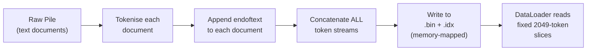
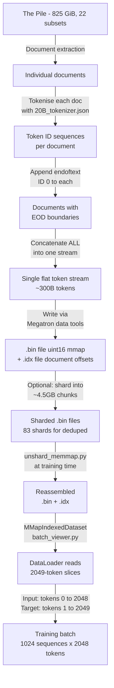

# Dissecting Tokenisation in EleutherAI's Pythia-6.9B: A Comprehensive Technical Analysis

**Author:** Research Analysis Report  
**Date:** October 2026  
**Subject:** Special Token Insertion, Formatting Handling, and Data Pipeline Architecture in the Pythia Model Suite  
**Primary Model Under Study:** [EleutherAI/pythia-6.9b](https://huggingface.co/EleutherAI/pythia-6.9b)

---

## Table of Contents

1. [Executive Summary](#1-executive-summary)
2. [Background & Motivation](#2-background--motivation)
3. [The Tokeniser Architecture](#3-the-tokeniser-architecture)
   - 3.1 [Tokeniser Type & Algorithm](#31-tokeniser-type--algorithm)
   - 3.2 [Vocabulary Composition](#32-vocabulary-composition)
   - 3.3 [The Pipeline: Normaliser → Pre-Tokeniser → Model → Post-Processor → Decoder](#33-the-pipeline-normaliser--pre-tokeniser--model--post-processor--decoder)
4. [Special Tokens: The Complete Map](#4-special-tokens-the-complete-map)
   - 4.1 [Token ID 0: `<|endoftext|>` — The Only Boundary Marker](#41-token-id-0-endoftext--the-only-boundary-marker)
   - 4.2 [Token ID 1: `<|padding|>` — Present but Never Used in Training](#42-token-id-1-padding--present-but-never-used-in-training)
   - 4.3 [What Pythia Does NOT Have: No BOS, No CLS, No SEP](#43-what-pythia-does-not-have-no-bos-no-cls-no-sep)
   - 4.4 [HuggingFace Aliasing: BOS = EOS = UNK = `<|endoftext|>`](#44-huggingface-aliasing-bos--eos--unk--endoftext)
5. [Where and How the Special Token is Inserted](#5-where-and-how-the-special-token-is-inserted)
   - 5.1 [During Pre-Tokenisation (Data Preparation for Training)](#51-during-pre-tokenisation-data-preparation-for-training)
   - 5.2 [The Concatenate-and-Split Strategy](#52-the-concatenate-and-split-strategy)
   - 5.3 [During Inference (HuggingFace Transformers)](#53-during-inference-huggingface-transformers)
6. [The Pre-Tokenised Data Format: MMap `.bin` + `.idx` Files](#6-the-pre-tokenised-data-format-mmap-bin--idx-files)
   - 6.1 [Binary File Structure](#61-binary-file-structure)
   - 6.2 [The Fixed 2049 Sequence Length](#62-the-fixed-2049-sequence-length)
   - 6.3 [How the DataLoader Consumes This](#63-how-the-dataloader-consumes-this)
7. [Formatting Preservation: Newlines, Whitespace, and Code](#7-formatting-preservation-newlines-whitespace-and-code)
   - 7.1 [Byte-Level BPE is Lossless](#71-byte-level-bpe-is-lossless)
   - 7.2 [The Ġ Prefix for Leading Spaces](#72-the-ġ-prefix-for-leading-spaces)
   - 7.3 [Newline Tokens](#73-newline-tokens)
   - 7.4 [Indentation-Aware Added Tokens (IDs 50254–50276)](#74-indentation-aware-added-tokens-ids-5025450276)
8. [The Training Config: pythia-6.9b.yml Decoded](#8-the-training-config-pythia-69byml-decoded)
9. [Comparison with BERT and GPT-2 Tokenisation](#9-comparison-with-bert-and-gpt-2-tokenisation)
10. [The Data Pipeline End-to-End: From Raw Text to Training Batch](#10-the-data-pipeline-end-to-end-from-raw-text-to-training-batch)
11. [Key Code Artefacts: Annotated Source Analysis](#11-key-code-artefacts-annotated-source-analysis)
12. [Practical Implications & Common Misconceptions](#12-practical-implications--common-misconceptions)
13. [Conclusions](#13-conclusions)
14. [References](#14-references)

---

## 1. Executive Summary

This report presents a forensic examination of how **EleutherAI's Pythia-6.9B** handles tokenisation, with specific focus on:

- **Where** special tokens are inserted (answer: during the data-preprocessing pipeline, *not* by the tokeniser at call time)
- **Which** special tokens exist (answer: only `<|endoftext|>` at ID 0 is functionally used; `<|padding|>` at ID 1 exists but is never used during pretraining)
- **How** formatting (newlines, whitespace, indentation) is preserved (answer: byte-level BPE ensures lossless round-trip encoding; 23 dedicated indentation tokens handle multi-space runs)

> [!IMPORTANT]
> The single most critical finding: **Pythia does NOT insert any special tokens automatically during the `tokenizer(text)` call.** The `<|endoftext|>` (EOD) token is appended to each document *during the offline data-preparation step*, before the tokenised data is written to memory-mapped binary files. The model trains on pre-tokenised `.bin` files where documents are concatenated with EOD separators and sliced into fixed-length 2048-token windows.

---

## 2. Background & Motivation

The Pythia suite was developed by EleutherAI with full reproducibility as a first-class goal. All models in the suite:

- Are trained on **The Pile** (an 825 GiB dataset of diverse text)
- Use the **same tokeniser** across all model sizes (the "20B tokenizer")
- See the **same data in the same order** (enabling causal interventions on the training process)
- Provide **154 checkpoints** per model for studying learning dynamics

The Pythia-6.9B model specifically has:

| Property | Value |
|---|---|
| Architecture | GPTNeoXForCausalLM |
| Layers | 32 |
| Hidden size | 4096 |
| Attention heads | 32 |
| Max position embeddings | 2048 |
| Vocab size | 50,432 |
| Training tokens | ~300 billion |
| Tokeniser | Byte-Level BPE (shared "20B tokenizer") |

Source: [pythia-6.9b.yml](./pythia/models/6.9B/pythia-6.9b.yml) and [HuggingFace config.json](https://huggingface.co/EleutherAI/pythia-6.9b/raw/main/config.json)

---

## 3. The Tokeniser Architecture

### 3.1 Tokeniser Type & Algorithm

The Pythia tokeniser is defined in [20B_tokenizer.json](./pythia/utils/20B_tokenizer.json), a 2.5 MB JSON file conforming to the HuggingFace `tokenizers` library format.

```json
"model": {
    "type": "BPE",
    "dropout": null,
    "unk_token": null,
    "continuing_subword_prefix": null,
    "end_of_word_suffix": null,
    "fuse_unk": false,
    "vocab": { ... }
}
```

Key characteristics:
- **Algorithm:** Byte-Pair Encoding (BPE)
- **Byte-level:** Uses the GPT-2 byte-to-unicode mapping, meaning every possible byte has a representation — there is **no UNK token at the model level** (`unk_token: null` in the BPE model config)
- **No dropout** during tokenisation (`dropout: null`)
- **No subword prefixes or suffixes** — unlike WordPiece (BERT's `##` prefix), BPE tokens in this tokeniser carry no positional markers

### 3.2 Vocabulary Composition

| Range | Count | Contents |
|---|---|---|
| 0 | 1 | `<\|endoftext\|>` (special, EOD/EOS token) |
| 1 | 1 | `<\|padding\|>` (special, padding token) |
| 2–255 | 254 | Individual byte tokens (single characters: `!`, `"`, `#`, `$`, `%`, etc.) |
| 256–50,253 | ~49,998 | BPE merge results (subwords and words) |
| 50,254–50,276 | 23 | Added tokens for multi-space indentation (24 spaces down to 2 spaces) |

**Total vocabulary size: 50,277 tokens** in the tokeniser JSON. However, the model's embedding matrix has **50,432 entries** (as stated in `config.json`). The difference (155 slots) consists of unused padding in the embedding matrix, rounded up for GPU efficiency (50,432 = 50,277 rounded to a multiple of 128 for tensor-core alignment).

### 3.3 The Pipeline: Normaliser → Pre-Tokeniser → Model → Post-Processor → Decoder

From [20B_tokenizer.json lines 232–249](./pythia/utils/20B_tokenizer.json#L232-L249):

```json
"normalizer": {
    "type": "NFC"
},
"pre_tokenizer": {
    "type": "ByteLevel",
    "add_prefix_space": false,
    "trim_offsets": true
},
"post_processor": {
    "type": "ByteLevel",
    "add_prefix_space": false,
    "trim_offsets": true
},
"decoder": {
    "type": "ByteLevel",
    "add_prefix_space": false,
    "trim_offsets": true
}
```

Detailed breakdown of each stage:

| Stage | Type | What It Does |
|---|---|---|
| **Normaliser** | NFC (Unicode Normalisation Form Canonical Composition) | Canonicalises Unicode characters (e.g., e with accent as a single codepoint, not e + combining accent). This is the *only* normalisation applied — no lowercasing, no whitespace stripping. |
| **Pre-Tokeniser** | ByteLevel | Converts the input string into a sequence of bytes using GPT-2's byte-to-unicode mapping. `add_prefix_space: false` means the tokeniser does **not** artificially insert a space at the beginning of the input. |
| **Model** | BPE | Applies learned merge rules to combine byte sequences into larger subword tokens. |
| **Post-Processor** | ByteLevel | In the Pythia tokeniser, the post-processor is a **plain ByteLevel pass-through** — it does **NOT** add any `[CLS]`, `[SEP]`, or `<s>` tokens. This is the critical difference from BERT. |
| **Decoder** | ByteLevel | Reverses the byte-to-unicode mapping to reconstruct the original text from token IDs. |

> [!CAUTION]
> **The post-processor is the place where BERT adds `[CLS]` and `[SEP]` automatically.** Pythia's post-processor is a plain ByteLevel processor that adds **nothing**. This means when you call `tokenizer("Hello world")`, you get the bare tokens with zero special tokens prepended or appended.

---

## 4. Special Tokens: The Complete Map

### 4.1 Token ID 0: `<|endoftext|>` — The Only Boundary Marker

From the tokeniser JSON:
```json
{
    "id": 0,
    "special": true,
    "content": "<|endoftext|>",
    "single_word": false,
    "lstrip": false,
    "rstrip": false,
    "normalized": false
}
```

This is the **End-of-Document (EOD) token**. Its function:
- Placed **between documents** in the concatenated training stream
- Signals to the model that unrelated content follows
- At token ID **0**, it is the very first entry in the vocabulary
- Being a `special` token means the tokeniser will never produce it by encoding regular text — it can only be inserted explicitly

### 4.2 Token ID 1: `<|padding|>` — Present but Never Used in Training

```json
{
    "id": 1,
    "special": true,
    "content": "<|padding|>",
    "single_word": false,
    "lstrip": false,
    "rstrip": false,
    "normalized": false
}
```

Despite existing in the vocabulary:
- The Pythia training pipeline uses the **concatenate-and-split** strategy, which produces **no padding** (every sequence is exactly 2048 tokens, except possibly the very last one, which is discarded)
- The `<|padding|>` token is there for downstream fine-tuning use cases where padding may be needed
- There is **no pad_token** set in the HuggingFace `tokenizer_config.json` (it only defines `bos_token`, `eos_token`, and `unk_token`)

### 4.3 What Pythia Does NOT Have: No BOS, No CLS, No SEP

Unlike BERT-family models and some Llama-family models, the Pythia tokeniser:
- Has **no `[CLS]` token** — there is no classification token prepended to inputs
- Has **no `[SEP]` token** — there is no separator token
- Has **no true BOS (Beginning-of-Sentence) token** — the `<|endoftext|>` at the end of the *previous* document implicitly serves as the "beginning" marker for the next document

### 4.4 HuggingFace Aliasing: BOS = EOS = UNK = `<|endoftext|>`

From the HuggingFace `special_tokens_map.json`:

```json
{
    "bos_token": "<|endoftext|>",
    "eos_token": "<|endoftext|>",
    "unk_token": "<|endoftext|>"
}
```

And from `tokenizer_config.json`:

```json
{
    "add_prefix_space": false,
    "bos_token": "<|endoftext|>",
    "eos_token": "<|endoftext|>",
    "name_or_path": "EleutherAI/gpt-neox-20b",
    "tokenizer_class": "GPTNeoXTokenizer",
    "unk_token": "<|endoftext|>"
}
```

> [!WARNING]
> All three special token roles (`bos_token`, `eos_token`, `unk_token`) are aliased to the **same token**: `<|endoftext|>` (ID 0). This is a common source of confusion. The tokeniser does NOT functionally distinguish between "beginning of sequence" and "end of sequence" — both map to the same ID. The model learns from context that this token acts as a boundary.

From `config.json`:
```json
{
    "bos_token_id": 0,
    "eos_token_id": 0
}
```

This confirms it at the model-configuration level as well.

---

## 5. Where and How the Special Token is Inserted

### 5.1 During Pre-Tokenisation (Data Preparation for Training)

**This is the most critical section of this report.**

The Pythia models are NOT trained on raw text that is tokenised on-the-fly. Instead, the training data follows this pipeline:



The `<|endoftext|>` token is appended to each document **during the data-preparation step**, before the data is written to the binary `.bin` file. This happens in the GPT-NeoX data-processing scripts, not in the tokeniser itself.

Evidence from [README.md line 280–281](./pythia/README.md#L280-L281):
> *"Note that documents are concatenated and separated by an `EOD` token. Thus, each sample or batch may not start with an EOD token."*

### 5.2 The Concatenate-and-Split Strategy

This is the standard pretraining approach, and Pythia follows it exactly:

```
Document A tokens: [t1, t2, ..., tN]
Document B tokens: [t1, t2, ..., tM]
Document C tokens: [t1, t2, ..., tK]

Concatenated stream:
[t1_A, t2_A, ..., tN_A, <|endoftext|>, t1_B, t2_B, ..., tM_B, <|endoftext|>, t1_C, ...]

Sliced into blocks (seq_length = 2048):
Block 1: [t1_A, t2_A, ...,  t2048_A]
Block 2: [t2049_A, ..., tN_A, <|endoftext|>, t1_B, ..., t_xxx_B]
Block 3: [t_xxx+1_B, ..., tM_B, <|endoftext|>, t1_C, ...]
```

**Key observations:**
1. The `<|endoftext|>` token appears *within* blocks, not at block boundaries
2. A block may contain multiple document boundaries (multiple `<|endoftext|>` tokens)
3. A block may start in the middle of a document — there is no guarantee of alignment
4. There is **zero padding** — every block is exactly 2048 tokens (plus 1 target token = 2049)

### 5.3 During Inference (HuggingFace Transformers)

When using the Pythia tokeniser for inference via HuggingFace:

```python
from transformers import AutoTokenizer
tokenizer = AutoTokenizer.from_pretrained("EleutherAI/pythia-6.9b")

# This does NOT add any special tokens:
tokens = tokenizer("Hello, world!")
# tokens["input_ids"] = [just the text tokens, nothing extra]
```

Because the post-processor is a plain ByteLevel pass-through:
- **No `<|endoftext|>` is prepended or appended** by default
- **No `[CLS]` or `[SEP]` is added**
- The `add_special_tokens=True` default has **no effect** because no template is defined

If you want to manually add the EOD token:
```python
eos_id = tokenizer.eos_token_id  # = 0
input_ids = tokenizer("Hello, world!")["input_ids"] + [eos_id]
```

---

## 6. The Pre-Tokenised Data Format: MMap `.bin` + `.idx` Files

### 6.1 Binary File Structure

The training data is stored as **Megatron-LM style memory-mapped datasets**, consisting of two files:
- **`.bin` file**: A flat binary array of token IDs (stored as `uint16` — 2 bytes per token)
- **`.idx` file**: An index file containing document boundaries and metadata

The index file format, as documented in [mmap_dataset.py](./pythia/utils/mmap_dataset.py):

```
[Magic bytes: "MMIDIDX\x00\x00" (9 bytes)]
[Version: uint64 (8 bytes)]
[Dtype code: uint8 (1 byte)]
[Number of sequences: uint64 (8 bytes)]
[Number of documents: uint64 (8 bytes)]
[Sizes array: int32 x num_sequences]
[Pointers array: int64 x num_sequences]
[Document index array: int64 x num_documents]
```

### 6.2 The Fixed 2049 Sequence Length

From [mmap_dataset.py line 17](./pythia/utils/mmap_dataset.py#L17):
```python
#       *************
#       **IMPORTANT**
#       *************
#   This Implementation assumes that the sequences in
#   the dataset are always of sequence length 2049
```

And from [line 228](./pythia/utils/mmap_dataset.py#L228):
```python
return np_array.reshape(-1, 2049)
```

Why 2049 and not 2048? Because the model's sequence length is 2048, but for causal language modelling, each training example needs 2048 input tokens and 2048 target tokens. The targets are the inputs **shifted left by 1 position**:

```
Input:   [t0,  t1,  t2,  ..., t2047]   (first 2048 of the 2049)
Target:  [t1,  t2,  t3,  ..., t2048]   (last 2048 of the 2049)
```

As confirmed by [README.md line 281](./pythia/README.md#L281):
> *"During training, target tokens are left shifted by 1. Thus, a model of sequence length 2048 requires 2049 length sequences for training."*

### 6.3 How the DataLoader Consumes This

The [batch_viewer.py](./pythia/utils/batch_viewer.py) script reveals the consumption pattern:

```python
dataset = MMapIndexedDataset(args.load_path, skip_warmup=True)
indicies = dataset[args.start_iteration*1024: (args.end_iteration+1)*1024]
```

Each iteration uses **1024 sequences** (the batch size in number of sequences). With 2049 tokens per sequence, each batch contains `1024 x 2049 = 2,098,176` token positions, but effectively `1024 x 2048 = 2,097,152` training tokens (the "2M" batch size mentioned in the README and config).

---

## 7. Formatting Preservation: Newlines, Whitespace, and Code

### 7.1 Byte-Level BPE is Lossless

Unlike BERT's WordPiece tokeniser (which lowercases text and normalises whitespace), the Pythia tokeniser is **fully lossless**. Given any byte string, encoding and then decoding will produce the exact original:

```python
text = "Hello\n\tWorld\n\n  def foo():\n    return 42"
assert tokenizer.decode(tokenizer.encode(text)) == text
```

This is because:
- The pre-tokeniser operates at the **byte level** using GPT-2's byte-to-unicode mapping
- The only normalisation is **NFC Unicode normalisation**, which does not alter ASCII characters
- `add_prefix_space: false` means no artificial leading space is injected

### 7.2 The Ġ Prefix for Leading Spaces

In the GPT-2 byte-to-unicode mapping, the space character (byte `0x20`) is mapped to `Ġ` (Unicode `\u0120`). Therefore, in the vocabulary:
- `"hello"` → the token `hello` (appears after a non-space character)
- `" hello"` → the token `Ġhello` (the leading space is part of the token)

This is visible in the vocabulary entries of [20B_tokenizer.json](./pythia/utils/20B_tokenizer.json):
```json
"vocab": {
    "Ġthe": 253,
    "Ġto": 281,
    "Ġand": 285
}
```

Most "word" tokens in the vocabulary include the leading space, because in natural text, words are preceded by spaces. This is an elegant design choice that avoids needing a separate "word boundary" marker.

### 7.3 Newline Tokens

In the byte-to-unicode mapping:
- `\n` (byte `0x0A`) maps to `Ċ` (Unicode `\u010a`)
- `\r` (byte `0x0D`) maps to `č` (Unicode `\u010d`)

The BPE merges produce tokens for common newline patterns:
- Single newline `\n` → its own token `Ċ`
- Double newline `\n\n` → merged into `ĊĊ`

This means **newlines are fully preserved** as first-class tokens. The model can learn paragraph structure, code formatting, and blank-line patterns directly.

### 7.4 Indentation-Aware Added Tokens (IDs 50254–50276)

A remarkable feature of the Pythia tokeniser is **23 special added tokens for multi-space runs**, defined in the `added_tokens` array:

| Token ID | Content | Spaces |
|---|---|---|
| 50254 | (24 spaces) | 24 spaces |
| 50255 | (23 spaces) | 23 spaces |
| 50256 | (22 spaces) | 22 spaces |
| 50257 | (21 spaces) | 21 spaces |
| ... | ... | ... |
| 50274 | (4 spaces) | 4 spaces |
| 50275 | (3 spaces) | 3 spaces |
| 50276 | (2 spaces) | 2 spaces |

These are **NOT marked as special tokens** (`"special": false`), meaning they are produced by normal tokenisation of text containing those space runs. They are `"normalized": true`, meaning NFC normalisation applies to them.

**Purpose:** These tokens dramatically improve efficiency when tokenising code and structured text. Without them, a 24-space indent would consume 24 individual space tokens (or multiple smaller merge tokens). With them, it's a single token.

This design shows that the Pythia tokeniser was deliberately engineered for The Pile's diverse content, which includes significant amounts of source code.

---

## 8. The Training Config: pythia-6.9b.yml Decoded

From [pythia-6.9b.yml](./pythia/models/6.9B/pythia-6.9b.yml):

```yaml
{
    # Tokeniser configuration
    "tokenizer_type": "HFTokenizer",
    "vocab-file": "/fsx/pile/20B_tokenizer.json",

    # Sequence configuration
    "seq-length": 2048,
    "max-position-embeddings": 2048,

    # Data configuration
    "data-impl": "mmap",
    "train-data-paths": ["/fsx/pile/pile_20B_tokenizer_text_document"],

    # Batch configuration (trained on 128 GPUs)
    "train_micro_batch_size_per_gpu": 8,
    "gradient_accumulation_steps": 2,
    # Total batch = 128 GPUs x 8 x 2 / (1 x 2) = 1024 sequences
    # = 1024 x 2048 = 2,097,152 tokens per step

    # Training duration
    "train-iters": 143000
    # Total tokens = 143,000 x 2,097,152 ~ 299.9 billion tokens
}
```

Tokeniser-relevant observations:
1. **`tokenizer_type: HFTokenizer`** — GPT-NeoX uses the HuggingFace tokeniser directly, loading from the JSON file
2. **`data-impl: mmap`** — confirms memory-mapped data reading (the pre-tokenised binary files)
3. **`vocab-file`** — points to the same `20B_tokenizer.json` used across all Pythia models
4. **No `tokenizer-type: GPT2BPETokenizer`** — unlike some other NeoX configs, Pythia uses the HF format, not the OpenAI format

---

## 9. Comparison with BERT and GPT-2 Tokenisation

| Feature | BERT (uncased) | GPT-2 | **Pythia (NeoX)** |
|---|---|---|---|
| Algorithm | WordPiece | Byte-Level BPE | **Byte-Level BPE** |
| Normalisation | Lowercase + accent strip + whitespace normalise | None | **NFC only** |
| BOS token | `[CLS]` (auto-inserted) | None | **None** (aliased to EOS) |
| EOS token | `[SEP]` (auto-inserted) | `<\|endoftext\|>` (manual) | **`<\|endoftext\|>` (manual / pre-inserted in data)** |
| PAD token | `[PAD]` | None (reuse EOS) | **`<\|padding\|>` (defined but unused in training)** |
| UNK token | `[UNK]` | None (byte-level) | **None (byte-level); aliased to EOS in HF config** |
| Auto-inserts special tokens? | Yes (`[CLS]` + `[SEP]`) | No | **No** |
| Preserves newlines? | No (stripped) | Yes | **Yes** |
| Preserves capitalisation? | No (lowercased) | Yes | **Yes** |
| Lossless round-trip? | No | Yes | **Yes** |
| Subword prefix | `##` | None | **None** |
| Leading space handling | Ignored | `Ġ` prefix | **`Ġ` prefix** |

> [!NOTE]
> The Pythia tokeniser is functionally identical to GPT-2's tokeniser in its core design. The differences are: (1) the vocabulary was trained on The Pile instead of WebText, (2) `<|padding|>` was added at ID 1, and (3) 23 multi-space indentation tokens were added at IDs 50254–50276. The NFC normaliser is also a minor addition.

---

## 10. The Data Pipeline End-to-End: From Raw Text to Training Batch



### Pipeline stage detail:

**Stage 1: Raw text → Token IDs**
- Each document from The Pile is tokenised independently using the 20B tokeniser
- The tokeniser produces a flat list of integer IDs per document
- No special tokens are added by the tokeniser itself

**Stage 2: Token IDs → Stream with boundaries**
- `<|endoftext|>` (ID 0) is appended to each document's token sequence
- All sequences are concatenated into one massive flat array

**Stage 3: Flat stream → Fixed-length sequences**
- The stream is cut into sequences of exactly 2049 tokens
- Each sequence becomes one training sample (2048 input + 1 for target offset)
- Documents that cross sequence boundaries are split — this is intentional

**Stage 4: Sequences → Binary files**
- Token IDs are written as `uint16` values to a `.bin` file
- Document boundaries and sequence sizes are stored in the `.idx` file
- Files are memory-mapped for efficient random access during training

**Stage 5: Sharding & distribution**
- The [shard_memmap.py](./pythia/utils/shard_memmap.py) script splits large `.bin` files into ~4.5 GB shards for distribution via HuggingFace Hub
- The [unshard_memmap.py](./pythia/utils/unshard_memmap.py) script reassembles them at training time
- [checksum_shards.py](./pythia/utils/checksum_shards.py) verifies SHA256 integrity after download

---

## 11. Key Code Artefacts: Annotated Source Analysis

### 11.1 `mmap_dataset.py` — The Data Reader

This file (adapted from Facebook/Megatron-LM) implements the `MMapIndexedDataset` class that reads the pre-tokenised binary data. Critical details:

**Index reading** ([lines 102–145](./pythia/utils/mmap_dataset.py#L102-L145)):
```python
# The index stores: sizes of each sequence, byte pointers, and document boundaries
self._sizes = np.frombuffer(self._bin_buffer, dtype=np.int32, count=self._len, offset=offset)
self._pointers = np.frombuffer(self._bin_buffer, dtype=np.int64, ...)
self._doc_idx = np.frombuffer(self._bin_buffer, dtype=np.int64, ...)
```

**Slice access** ([lines 218–228](./pythia/utils/mmap_dataset.py#L218-L228)):
```python
elif isinstance(idx, slice):
    # ...
    np_array = np.frombuffer(self._bin_buffer, dtype=self._index.dtype, count=total_size, offset=ptr)
    return np_array.reshape(-1, 2049)  # HARDCODED: 2049 tokens per sequence
```

The hardcoded `2049` is a crucial implementation detail — the dataset is structured as a grid where each row is one training sequence.

### 11.2 `batch_viewer.py` — Inspecting Training Data

From [batch_viewer.py](./pythia/utils/batch_viewer.py):
```python
dataset = MMapIndexedDataset(args.load_path, skip_warmup=True)
indicies = dataset[args.start_iteration*1024: (args.end_iteration+1)*1024]
np.save(filename, indicies)
```

This tool allows researchers to extract exactly which token sequences the model saw at any given training step. The `*1024` multiplier corresponds to the batch size (1024 sequences per iteration).

### 11.3 `eval_memorization.py` — How Tokenised Data Is Used at Eval

From [eval_memorization.py](./pythia/predictable-memorization/eval_memorization.py):

```python
buff_size = 2049 * batch_size * 2  # 2 bytes per uint16 token
# ...
data = np.frombuffer(data, dtype=np.uint16).reshape(-1, 2049)
context_tokens.extend(data[:, :32].tolist())      # First 32 tokens = context
true_continuation.extend(data[:, 32:64].tolist())  # Next 32 tokens = ground truth
```

This reveals:
- Tokens are stored as **uint16** (2 bytes each), confirming vocab fits in 16-bit integers
- The memorization study treats the first 32 tokens of each 2049-sequence as "context" and the next 32 as "true continuation"
- The data is read directly from the binary stream — no re-tokenisation occurs

---

## 12. Practical Implications & Common Misconceptions

### Misconception 1: "The tokeniser adds `<|endoftext|>` automatically"
**Reality:** The Pythia tokeniser does NOT add any special tokens when you call `tokenizer(text)`. The `<|endoftext|>` is only present because it was manually inserted during data preprocessing. For inference, you must add it yourself if needed.

### Misconception 2: "BOS and EOS are different tokens in Pythia"
**Reality:** `bos_token_id = eos_token_id = 0`. They are the same token (`<|endoftext|>`). The HuggingFace config defines them separately for API compatibility, but they refer to the identical token.

### Misconception 3: "Padding was used during Pythia training"
**Reality:** The concatenate-and-split strategy eliminates all padding. Every training sequence is exactly 2048 tokens (2049 including the target offset). The `<|padding|>` token at ID 1 was defined for potential downstream use, not for pretraining.

### Misconception 4: "Each training sequence starts with a document"
**Reality:** Sequences are cut from a continuous stream. A sequence can begin mid-sentence, mid-word even. The `<|endoftext|>` tokens appear at arbitrary positions within sequences, wherever document boundaries happen to fall.

### Misconception 5: "Newlines are lost during tokenisation"
**Reality:** Byte-level BPE is fully lossless. Newlines (`\n`) become the `Ċ` token (or part of merged tokens like `ĊĊ` for `\n\n`). All whitespace, punctuation, and formatting is preserved exactly.

### Misconception 6: "The vocabulary size is 50,277"
**Reality:** While the tokeniser JSON contains 50,277 tokens, the model's embedding matrix has **50,432 entries** (rounded to a multiple of 128 for GPU tensor-core efficiency). The extra 155 entries are unused padding in the embedding table.

---

## 13. Conclusions

### Summary of Findings

1. **Tokeniser Type**: Pythia uses a byte-level BPE tokeniser (the "20B tokenizer"), shared across all model sizes. It is nearly identical in design to GPT-2's tokeniser, with additions for padding and code-indentation tokens.

2. **Special Token Insertion Point**: The `<|endoftext|>` token is inserted **exclusively during the offline data-preparation pipeline**, not by the tokeniser at call time. The tokeniser's post-processor adds nothing.

3. **Single Special Token Used**: Only `<|endoftext|>` (ID 0) is functionally used during training. It serves triple duty: end-of-document marker, effective beginning-of-document marker (for the next document), and the HuggingFace-required BOS/EOS/UNK alias.

4. **No Padding During Training**: The concatenate-and-split strategy produces fixed-length 2048-token sequences with zero padding. `<|padding|>` (ID 1) exists in the vocabulary but is never seen during pretraining.

5. **Lossless Formatting**: Byte-level BPE preserves all formatting — newlines, indentation, capitalisation, special characters. This is in sharp contrast to BERT, which destroys much of this information.

6. **Data Format**: Training data is stored as pre-tokenised, memory-mapped binary files (`.bin` + `.idx`) in Megatron-LM format. Sequences are 2049 tokens long (2048 input + 1 for target offset). The data is sharded for distribution and reassembled at training time.

7. **Training Scale**: 143,000 iterations x 1024 sequences x 2048 tokens = ~299.9 billion tokens total.

### What This Means For Your Learning

The key architectural insight from studying Pythia is that **tokenisation and data formatting are two separate concerns**:

- The **tokeniser** converts text to integers and back. It is a stateless, per-document operation.
- The **data pipeline** adds document boundaries, concatenates, and slices. It is a corpus-level operation.

Understanding this separation is essential for anyone studying how large language models are trained. The `claude.txt` conversation you had was building toward this understanding — from BERT's per-sentence `[CLS]/[SEP]` model to GPT-style document-boundary-only model to the full concatenate-and-split pretraining strategy that Pythia uses.

---

## 14. References

| # | Source | Description |
|---|---|---|
| 1 | [Pythia Paper](https://arxiv.org/abs/2304.01373) | Original Pythia suite paper (arXiv:2304.01373) |
| 2 | [Pythia README.md](./pythia/README.md) | Repository README with training reproduction instructions |
| 3 | [20B_tokenizer.json](./pythia/utils/20B_tokenizer.json) | The actual tokeniser definition file |
| 4 | [pythia-6.9b.yml](./pythia/models/6.9B/pythia-6.9b.yml) | GPT-NeoX training configuration |
| 5 | [mmap_dataset.py](./pythia/utils/mmap_dataset.py) | Memory-mapped dataset reader |
| 6 | [batch_viewer.py](./pythia/utils/batch_viewer.py) | Training data inspection tool |
| 7 | [eval_memorization.py](./pythia/predictable-memorization/eval_memorization.py) | Memorization evaluation script |
| 8 | [HuggingFace: pythia-6.9b](https://huggingface.co/EleutherAI/pythia-6.9b) | Model card and config files |
| 9 | [GPT-NeoX library](https://github.com/EleutherAI/gpt-neox) | Training framework used for Pythia |
| 10 | [The Pile](https://arxiv.org/abs/2101.00027) | Training data paper (arXiv:2101.00027) |
| 11 | [claude.txt](./claude.txt) | Prior conversation context and learning journey |
