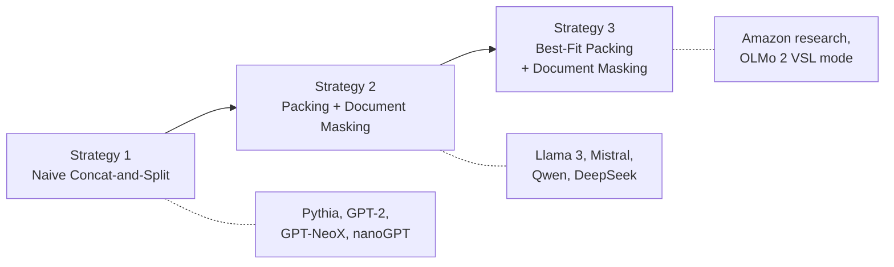
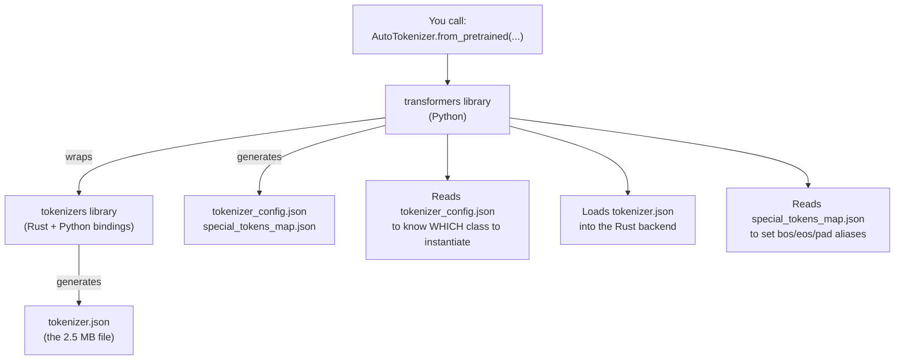
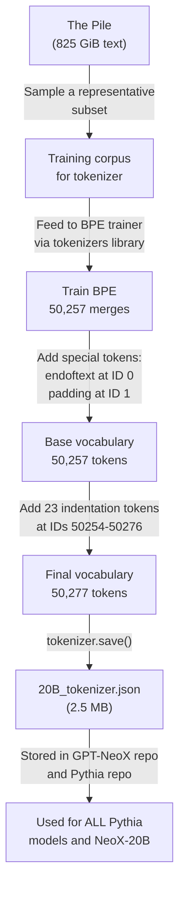
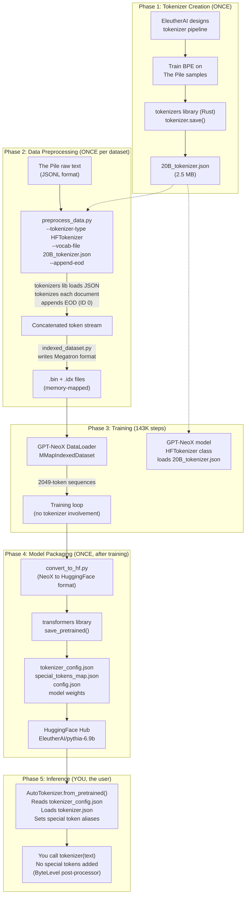

# Pythia Tokenisation Follow-Up: Cross-Model Strategies, Truncation Costs, and the HuggingFace Toolchain

**Date:** October 2026  
**Builds On:** [1.pythia_tokenisation_analysis.md](./1.pythia_tokenisation_analysis.md)  
**Scope:** Answers to three deep questions arising from the original report

---

## Table of Contents

1. [Question 1: How Do Other Open-Source Models Handle Concat-and-Split?](#1-how-do-other-open-source-models-handle-concat-and-split)
   - 1.1 [The Three Strategies That Exist](#11-the-three-strategies-that-exist)
   - 1.2 [Pythia / GPT-NeoX: Naive Concat-and-Split](#12-pythia--gpt-neox-naive-concat-and-split)
   - 1.3 [Llama 3: Packing + Document Masking](#13-llama-3-packing--document-masking)
   - 1.4 [OLMo 2: Variable Sequence Length](#14-olmo-2-variable-sequence-length)
   - 1.5 [Mistral / Qwen / DeepSeek](#15-mistral--qwen--deepseek)
   - 1.6 [Master Comparison Table](#16-master-comparison-table)
2. [Question 2: Is Pythia OK with Abrupt Sentence Breaking? And How Do Modern LLMs Address the Cross-Sequence Problem?](#2-is-pythia-ok-with-abrupt-sentence-breaking)
   - 2.1 [Yes, Pythia Deliberately Breaks Sentences Mid-Stream](#21-yes-pythia-deliberately-breaks-sentences-mid-stream)
   - 2.2 [Why It Works Despite Being "Wrong"](#22-why-it-works-despite-being-wrong)
   - 2.3 [What Exactly Is Lost: The Truncation Cost](#23-what-exactly-is-lost-the-truncation-cost)
   - 2.4 [The Cross-Sequence Blindness Problem](#24-the-cross-sequence-blindness-problem)
   - 2.5 [Modern Solutions: Not Architecture, Mostly Data Pipeline](#25-modern-solutions-not-architecture-mostly-data-pipeline)
   - 2.6 [Modern Solutions: Architecture-Level Approaches](#26-modern-solutions-architecture-level-approaches)
   - 2.7 [Summary: What Solves What](#27-summary-what-solves-what)
3. [Question 3: Where Do All Those HuggingFace JSON Files Come From?](#3-where-do-all-those-huggingface-json-files-come-from)
   - 3.1 [Two Libraries, Not One](#31-two-libraries-not-one)
   - 3.2 [The `tokenizers` Library (Rust): The Engine](#32-the-tokenizers-library-rust-the-engine)
   - 3.3 [The `transformers` Library (Python): The Wrapper](#33-the-transformers-library-python-the-wrapper)
   - 3.4 [Which File Comes from Where: The Definitive Map](#34-which-file-comes-from-where-the-definitive-map)
   - 3.5 [How Pythia's 20B_tokenizer.json Was Actually Created](#35-how-pythias-20b_tokenizerjson-was-actually-created)
   - 3.6 [How GPT-NeoX Loads It During Training](#36-how-gpt-neox-loads-it-during-training)
   - 3.7 [How the HuggingFace Config Files Were Generated After Training](#37-how-the-huggingface-config-files-were-generated-after-training)
   - 3.8 [The `preprocess_data.py` Script: Where `<|endoftext|>` Actually Gets Inserted](#38-the-preprocess_datapy-script-where-endoftext-actually-gets-inserted)
   - 3.9 [The Full Software Stack Diagram](#39-the-full-software-stack-diagram)
   - 3.10 [Why No Tutorial Covers This](#310-why-no-tutorial-covers-this)
4. [References](#4-references)

---

## 1. How Do Other Open-Source Models Handle Concat-and-Split?

### 1.1 The Three Strategies That Exist

Before comparing models, you need to know that the entire LLM world uses **one of three strategies** for converting variable-length documents into fixed-length training sequences. They lie on a spectrum from "simple but wasteful" to "complex but optimal":



### 1.2 Pythia / GPT-NeoX: Naive Concat-and-Split

This is what Pythia does (as covered in the previous report):

```
Doc A: [a1 a2 a3 a4 a5]  Doc B: [b1 b2 b3]  Doc C: [c1 c2 c3 c4 c5 c6 c7]

Stream: [a1 a2 a3 a4 a5 EOD b1 b2 b3 EOD c1 c2 c3 c4 c5 c6 c7 EOD]

Sliced (seq_len=6):
  Seq 1: [a1 a2 a3 a4 a5 EOD]         ← all of Doc A, clean boundary
  Seq 2: [b1 b2 b3 EOD c1 c2]         ← Doc B complete, Doc C starts mid-sequence
  Seq 3: [c3 c4 c5 c6 c7 EOD]         ← Doc C continues from previous sequence

Attention: FULL causal attention across everything, including across EOD boundaries
```

**Properties:**
- Zero padding waste (every position is a real token)
- The model CAN attend from `c2` back to `b1` — it sees tokens from a completely different document
- Documents get chopped at arbitrary positions
- The EOD token is the only hint to the model that a boundary exists

**Who uses this:** Pythia, GPT-2, GPT-J, GPT-NeoX-20B, nanoGPT, early Llama 1, most academic/research models

### 1.3 Llama 3: Packing + Document Masking

Llama 3 (Meta, 2024) introduced a significant improvement. They STILL concatenate documents into sequences, but they add a **4D attention mask** that prevents the model from attending across document boundaries:

```
Seq 2: [b1 b2 b3 EOD c1 c2]

Attention mask (causal + document masking):
         b1  b2  b3  EOD  c1  c2
  b1   [ 1   0   0   0    0   0 ]
  b2   [ 1   1   0   0    0   0 ]
  b3   [ 1   1   1   0    0   0 ]
  EOD  [ 0   0   0   0    0   0 ]     ← EOD attends to nothing (or itself)
  c1   [ 0   0   0   0    1   0 ]     ← c1 CANNOT see b1, b2, b3
  c2   [ 0   0   0   0    1   1 ]     ← c2 can only see c1 and itself
```

The "4D" refers to the mask shape: `(batch_size, 1, query_length, kv_length)`. The `1` dimension broadcasts across all attention heads.

**What this solves:**
- The model no longer learns spurious correlations across document boundaries
- Each document fragment is treated as an independent context
- Significantly reduces hallucinations (the Fewer Truncations paper measures a 58% reduction)

**What this does NOT solve:**
- Documents still get truncated mid-sentence — you still lose context at the start of a new block
- The first token of Doc C in Seq 2 (`c1`) has very little context — it can only attend to itself and `c2`
- Compute is still "wasted" on these short fragments

**Llama 3's reported finding:** Meta noted in their technical report that document masking has limited impact during standard large-scale pretraining (the model sees so much data that it learns to use EOD as a boundary anyway). However, it becomes **critical** during continued pretraining and long-context training.

### 1.4 OLMo 2: Variable Sequence Length

OLMo 2 (Allen AI, 2024) takes a different approach with their **Variable Sequence Length (VSL)** data loader:

```
Instead of fixed 2048-token blocks:

Fixed (Pythia):  [a1..a2048]  [a2049..a4096]  [a4097..b300]  ...
Variable (OLMo): [a1..a3200]  [b1..b1800]  [c1..c4000]  [d1..d500 e1..e1500]  ...
```

The `NumpyVSLDataLoader` in OLMo-core can handle sequences of different lengths within the same batch, padding or packing as needed. This preserves document boundaries more naturally — short documents don't need to be concatenated with unrelated text, and long documents are only split where necessary.

**Who uses this:** OLMo 2 (optionally; they also support FSL mode which is classic concat-and-split)

### 1.5 Mistral / Qwen / DeepSeek

These models generally follow the **Llama 3 pattern** (packing with document masking), though their exact implementations differ:

- **Mistral:** Uses sliding window attention (more on this in Question 2) combined with document-aware packing. Their training pipeline is not fully open, but the architecture supports document isolation.
- **Qwen 2.5:** Follows Llama-3-style packing with attention masking. Uses a larger context window (up to 32K tokens in training, extended to 128K+).
- **DeepSeek V3/R1:** Uses Multi-Head Latent Attention (MLA) which compresses KV caches, combined with document masking during packing. Their tokenizer is Tiktoken-based.

### 1.6 Master Comparison Table

| Model | Year | Strategy | Doc Masking | Seq Length | Tokenizer | EOD Token | Special Notes |
|---|---|---|---|---|---|---|---|
| **GPT-2** | 2019 | Naive concat-split | No | 1024 | Byte BPE (GPT-2) | `<\|endoftext\|>` (50256) | The original pattern |
| **Pythia** | 2023 | Naive concat-split | No | 2048 | Byte BPE (20B) | `<\|endoftext\|>` (0) | Same strategy as GPT-2, bigger |
| **Llama 1** | 2023 | Naive concat-split | No | 2048 | SentencePiece | `</s>` (2) | Did NOT use doc masking yet |
| **Llama 2** | 2023 | Naive concat-split | No | 4096 | SentencePiece | `</s>` (2) | Still no doc masking |
| **Llama 3** | 2024 | Packing + masking | **Yes (4D mask)** | 8192 | Tiktoken (BPE) | `<\|end_of_text\|>` (128001) | First major model with doc masking |
| **Mistral** | 2023 | Packing + masking | Yes | 8192 → 32K | SentencePiece | `</s>` | Sliding window attention |
| **OLMo 1** | 2024 | Naive concat-split | No | 2048 | Byte BPE (Dolma) | EOD | Same as Pythia |
| **OLMo 2** | 2024 | VSL or FSL (choice) | Via VSL loader | 4096 | cl100k-based | EOD | Variable-length option |
| **DeepSeek V3** | 2024 | Packing + masking | Yes | 4096 → 128K | Tiktoken | EOT | MLA architecture |
| **Qwen 2.5** | 2024 | Packing + masking | Yes | 32K → 128K | Tiktoken-like | Special EOT | Large context |

> [!IMPORTANT]
> **The trend is clear:** Models released before mid-2024 mostly used naive concat-and-split (including Pythia, Llama 1, Llama 2, OLMo 1). From Llama 3 onwards, document masking during packing became the standard. This is a **data pipeline** change, not an architecture change — you don't need a new kind of transformer to do it.

---

## 2. Is Pythia OK with Abrupt Sentence Breaking?

### 2.1 Yes, Pythia Deliberately Breaks Sentences Mid-Stream

This is not a bug — it is the intended behavior. When the concatenated token stream is sliced into 2048-token blocks, the cut point falls wherever it falls. A sequence can start mid-word, mid-sentence, or even mid-paragraph. The model sees things like:

```
Sequence 1423: [...ing the constitution of the United States. EOD Ingredients: 2 cups
Sequence 1424:  flour, 1 cup sugar, 3 eggs. Preheat oven to 350°F. Mix the dry ingred
Sequence 1425: ients together in a large bowl. EOD The quantum mechanical description of...]
```

Sequence 1424 starts with `flour` — there is no context about what recipe this belongs to. The model has no way to know what came before.

### 2.2 Why It Works Despite Being "Wrong"

Three reasons:

**1. The model sees millions of complete sentences in other positions.**  
Even though some sentences are broken at sequence boundaries, the vast majority of sentences in the ~300 billion token corpus appear fully intact *within* sequences. The model learns grammar, syntax, and semantics from these complete examples. A few broken ones at the edges are noise in a massive signal.

**2. The loss function handles it gracefully.**  
The causal language modelling loss is computed per-token. For the first few tokens of a sequence that starts mid-document, the model may predict poorly (it has no context), but these are a tiny fraction of the `1024 × 2048 = 2,097,152` tokens in each batch. The gradient signal from these "bad" positions is swamped by the gradient from the millions of well-contextualized positions.

**3. The model learns to use `<|endoftext|>` as a reset signal.**  
Over billions of training tokens, the model learns that after `<|endoftext|>`, the topic changes completely. It learns to "reset" its internal state when it encounters this token. This is an emergent behavior, not something explicitly programmed.

### 2.3 What Exactly Is Lost: The Truncation Cost

The paper you're referencing is likely **"Fewer Truncations Improve Language Modeling"** (Ding et al., ICML 2024, Amazon Science). Their findings:

> [!WARNING]
> **The cost of naive concat-and-split is real and measurable:**
> - Reading comprehension performance drops because the model sometimes learns to attend across unrelated document boundaries
> - Closed-domain hallucinations increase by up to 58% compared to best-fit packing
> - Program synthesis (code generation) degrades because code files are often split mid-function
> - Context-following tasks suffer because the model learns that "context" can bleed across boundaries

Their proposed solution: **Best-Fit-Decreasing (BFD) bin packing** — treat each document as an item, each training sequence as a "bin" of capacity `seq_length`, and use the classic bin-packing heuristic to fit whole documents into sequences with minimal splitting.

```
Best-Fit Packing Example (bin = 10 tokens):

Documents: A(7 tokens), B(3 tokens), C(6 tokens), D(4 tokens), E(2 tokens)

Naive concat-split:
  Bin 1: [A A A A A A A B B B]     ← A and B packed, clean split
  Bin 2: [C C C C C C D D D D]     ← C and D packed by luck
  Bin 3: [E E PAD PAD PAD PAD PAD PAD PAD PAD]  ← 80% waste!

Best-Fit Packing:
  Bin 1: [A A A A A A A B B B]     ← A(7) + B(3) = 10, perfect fit
  Bin 2: [C C C C C C D D D D]     ← C(6) + D(4) = 10, perfect fit  
  Bin 3: [E E PAD PAD PAD PAD PAD PAD PAD PAD]  ← still short, but unavoidable
```

The key insight: with BFD, every document boundary is also a sequence boundary (or an explicit EOD token between documents that were packed together). No document is ever split mid-sentence unless it exceeds `seq_length` by itself.

### 2.4 The Cross-Sequence Blindness Problem

You correctly identified this: **one sequence window cannot see tokens from another sequence window.** This is a fundamental limitation of the transformer architecture during training:

```
Sequence N:   [... the patient was diagnosed with acute myocardial]
Sequence N+1: [infarction and was immediately transferred to the ICU]

During training:
- Sequence N+1's first token "infarction" cannot attend to "myocardial" in Sequence N
- The model must predict "infarction" with NO context of the previous sentence
- This is pure information loss
```

This is NOT a tokeniser problem — it's a **context window problem**. The tokeniser is doing its job correctly. The limitation comes from:
1. The fixed context window (2048 tokens for Pythia)
2. The fact that sequences are trained independently (no state carries over between sequences)

### 2.5 Modern Solutions: Not Architecture, Mostly Data Pipeline

Here's the thing most tutorials get wrong: **the solutions to the truncation problem are mostly NOT architectural.** They are data-pipeline solutions:

**Solution 1: Longer context windows (simple but expensive)**
```
Pythia (2023):  2,048 tokens
Llama 3 (2024): 8,192 tokens → extended to 128K
Qwen 2.5:      32,768 tokens → extended to 128K+
```
By making the window bigger, fewer documents get split. A 128K window can hold an entire book chapter. But training with longer sequences is quadratically more expensive in attention computation.

**Solution 2: Document masking (the Llama 3 approach)**

As described in Section 1.3. This doesn't prevent truncation, but it prevents the model from learning spurious cross-document correlations. When Doc A and Doc B are packed together, the model can't attend from B's tokens to A's tokens.

**Solution 3: Best-Fit Packing (the Amazon paper approach)**

Minimise how many documents get split in the first place. Most documents in a typical corpus are shorter than the context window, so BFD can pack them whole. Only the truly long documents (exceeding `seq_length`) need to be split.

**Solution 4: In-Context Pretraining (ordering related documents together)**

Papers like "In-Context Pretraining" (Shi et al., 2023) cluster semantically related documents and place them adjacent in the training stream. This way, when a sequence boundary falls between two documents, the next document is at least topically related, reducing the context discontinuity.

### 2.6 Modern Solutions: Architecture-Level Approaches

Now, to answer your specific question about MLA and fancy transformer architectures — **these exist, but they solve a different problem**:

**Multi-Head Latent Attention (MLA) — DeepSeek V2/V3**
```
Standard MHA:  KV cache per head = O(seq_length × num_heads × head_dim)
MLA:           KV cache = O(seq_length × latent_dim)  where latent_dim << num_heads × head_dim
```
MLA compresses the Key-Value representations into a low-rank latent space. This does NOT help the cross-sequence problem at all. It solves the **inference memory** problem — allowing you to serve longer contexts without running out of GPU memory. During training, the data pipeline is the same.

**Sliding Window Attention — Mistral**
```
Full attention:    every token attends to all previous tokens
Sliding window:   every token only attends to the last W tokens (e.g., W = 4096)
```
This reduces the quadratic cost of attention for long sequences. Combined with layer stacking (lower layers use local window, upper layers use full), it allows the model to have a large effective context while being efficient. But again, this doesn't solve the cross-sequence problem — it's about efficiency within a single sequence.

**Mixture of Experts (MoE) — Mixtral, DeepSeek**

MoE routes different tokens to different expert subnetworks. This increases model capacity without proportionally increasing compute. It has **nothing to do** with the cross-sequence or truncation problem.

**RoPE Scaling / YaRN / NTK-aware scaling**

These are techniques to extend a model's context window beyond what it was trained on (e.g., training at 4K, inference at 128K). They modify the rotary position embeddings to extrapolate to longer positions. This helps with the context window limitation but is an inference-time trick, not a training data pipeline solution.

### 2.7 Summary: What Solves What

| Problem | Solution | Is it Architecture? | Who Does It? |
|---|---|---|---|
| Documents split mid-sentence | Best-Fit Packing | No (data pipeline) | Amazon research, OLMo 2 |
| Cross-document attention leakage | Document masking (4D attention mask) | Partially (mask, not architecture) | Llama 3, Mistral, DeepSeek |
| Context window too short | Longer training sequence length | No (config change, more compute) | All modern models |
| KV cache too large at inference | MLA | Yes (architecture change) | DeepSeek V2/V3/R1 |
| Quadratic attention cost | Sliding window, sparse attention | Yes (architecture change) | Mistral, Mixtral |
| Positional generalisation beyond training length | RoPE scaling, YaRN | Yes (modification to embeddings) | Almost all 2024+ models |
| Related info spread across sequences | In-Context Pretraining | No (data ordering) | Research-stage |

> [!NOTE]
> **The bottom line:** The paper you read is correct — naive concat-and-split (what Pythia uses) does cause measurable information loss. Modern models solve this primarily through **data pipeline improvements** (document masking, best-fit packing), not through fancy transformer architectures. MLA, sliding window attention, and MoE solve different problems (efficiency, memory, capacity). These are orthogonal solutions that are often used together.

---

## 3. Where Do All Those HuggingFace JSON Files Come From?

This is the question nobody answers in tutorials, because the answer involves understanding **two separate software libraries** and **three separate moments** in a model's lifecycle.

### 3.1 Two Libraries, Not One

Most people think "HuggingFace" is one thing. It's not. There are two distinct libraries involved in tokenisation:

| Library | Language | PyPI Package | GitHub Repo | What It Does |
|---|---|---|---|---|
| **`tokenizers`** | **Rust** (Python bindings) | `tokenizers` | [huggingface/tokenizers](https://github.com/huggingface/tokenizers) | The low-level engine that actually does tokenisation. Implements BPE, WordPiece, Unigram, etc. Handles the full pipeline: normalise → pre-tokenise → model → post-process → decode. |
| **`transformers`** | **Python** | `transformers` | [huggingface/transformers](https://github.com/huggingface/transformers) | The high-level ML framework. Wraps `tokenizers` in Python classes, adds model-specific logic, defines special token conventions, handles model loading/saving, provides `AutoTokenizer`. |

The relationship is:



### 3.2 The `tokenizers` Library (Rust): The Engine

This is the library that produces the `tokenizer.json` file — the 2.5 MB file you see at [20B_tokenizer.json](./pythia/utils/20B_tokenizer.json).

**How you create a tokenizer with it:**

```python
from tokenizers import Tokenizer, models, trainers, pre_tokenizers, normalizers, decoders

# 1. Create a blank BPE tokenizer
tokenizer = Tokenizer(models.BPE())

# 2. Set up the pipeline
tokenizer.normalizer = normalizers.NFC()
tokenizer.pre_tokenizer = pre_tokenizers.ByteLevel(add_prefix_space=False)
tokenizer.decoder = decoders.ByteLevel()

# 3. Train it on your data
trainer = trainers.BpeTrainer(
    vocab_size=50257,
    special_tokens=["<|endoftext|>", "<|padding|>"]
)
tokenizer.train(files=["pile_shard_001.txt", "pile_shard_002.txt", ...], trainer=trainer)

# 4. Save it — THIS produces 20B_tokenizer.json
tokenizer.save("20B_tokenizer.json")
```

**What `tokenizer.save()` serialises into the JSON:**
- The `normalizer` config (`{"type": "NFC"}`)
- The `pre_tokenizer` config (`{"type": "ByteLevel", "add_prefix_space": false, ...}`)
- The `model` (BPE) with its full vocabulary and merge rules (~100K lines of merges)
- The `post_processor` config
- The `decoder` config
- The `added_tokens` array (including the `<|endoftext|>` and `<|padding|>` and the 23 indentation tokens)

**What it does NOT contain:**
- No `bos_token` / `eos_token` / `pad_token` aliases — those are a `transformers` concept
- No `model_max_length` — that's a model property, not a tokenizer property
- No `tokenizer_class` name — the Rust library doesn't know about Python class names

### 3.3 The `transformers` Library (Python): The Wrapper

The `transformers` library adds a Python wrapper around the Rust tokenizer. This wrapper:
- Assigns **semantic roles** to tokens (BOS, EOS, PAD, UNK, MASK, etc.)
- Defines **how** to apply the tokenizer in context (max length, truncation strategy, padding strategy)
- Provides `save_pretrained()` which generates the config files
- Provides `AutoTokenizer.from_pretrained()` which reconstructs everything

### 3.4 Which File Comes from Where: The Definitive Map

| File | Generated By | When | Contains | Pythia Example |
|---|---|---|---|---|
| **`tokenizer.json`** (or `20B_tokenizer.json`) | `tokenizers` library (Rust) via `tokenizer.save()` | **Before training** — when the tokeniser is designed and trained on the corpus | Full vocab, merge rules, pipeline config. The "engine definition." | [20B_tokenizer.json](./pythia/utils/20B_tokenizer.json) — 2.5 MB, 100K+ lines |
| **`tokenizer_config.json`** | `transformers` library (Python) via `save_pretrained()` | **After training** — when the model is packaged for distribution on HuggingFace Hub | Token role aliases (bos, eos, pad, unk), tokenizer class name, model max length | `{"bos_token": "<\|endoftext\|>", "eos_token": "<\|endoftext\|>", "tokenizer_class": "GPTNeoXTokenizer"}` |
| **`special_tokens_map.json`** | `transformers` library (Python) via `save_pretrained()` | **After training** — same as above | Dedicated mapping of special token roles to token strings | `{"bos_token": "<\|endoftext\|>", "eos_token": "<\|endoftext\|>", "unk_token": "<\|endoftext\|>"}` |
| **`vocab.json`** | `transformers` library (Python) — LEGACY format | Sometimes generated for backward compatibility | Token-to-ID mapping (redundant with tokenizer.json) | May or may not exist for Pythia |
| **`merges.txt`** | `transformers` library (Python) — LEGACY format | Sometimes generated for backward compatibility | BPE merge rules in text format (redundant with tokenizer.json) | May or may not exist for Pythia |
| **`config.json`** | `transformers` library — model config, NOT tokenizer | **After training** — model packaging | Model architecture params: `vocab_size`, `bos_token_id`, `eos_token_id`, hidden sizes, etc. | `{"vocab_size": 50432, "bos_token_id": 0, "eos_token_id": 0, ...}` |

> [!TIP]
> **The mental model:** Think of it like a car engine vs a car dashboard.
> - `tokenizer.json` = the engine (designed and built by the `tokenizers` library)
> - `tokenizer_config.json` + `special_tokens_map.json` = the dashboard labels ("this button is ignition, this is horn") added by `transformers`
> - `config.json` = the car's spec sheet (how many cylinders, how much horsepower) from the model itself

### 3.5 How Pythia's 20B_tokenizer.json Was Actually Created

The Pythia tokenizer was **not created for Pythia specifically**. It was created for the **GPT-NeoX-20B** model (hence the name "20B tokenizer") and then reused across all Pythia models.

The creation process was:



**Evidence from the codebase:**

The `tokenizer_config.json` on HuggingFace contains:
```json
"name_or_path": "EleutherAI/gpt-neox-20b"
```

This reveals that the tokenizer was originally created for NeoX-20B and the Pythia models inherited it. The `name_or_path` field is a vestige from when the tokenizer was first wrapped in a `transformers` Python class — it records the original model it was associated with.

### 3.6 How GPT-NeoX Loads It During Training

From the GPT-NeoX source code (`megatron/tokenizer/tokenizer.py`), the `HFTokenizer` class loads the JSON file directly using the **`tokenizers` Rust library** (NOT `transformers`):

```python
from tokenizers import Tokenizer   # This is the RUST library

class HFTokenizer:
    def __init__(self, vocab_file):
        # Loads directly from the JSON file using the Rust backend
        self.tokenizer = Tokenizer.from_file(vocab_file)
        # ...
    
    @property
    def eod(self):
        # Returns the EOD token ID — used by preprocess_data.py
        return self.tokenizer.token_to_id("<|endoftext|>")  # = 0
```

And in the training config ([pythia-6.9b.yml](./pythia/models/6.9B/pythia-6.9b.yml)):

```json
"tokenizer_type": "HFTokenizer",
"vocab-file": "/fsx/pile/20B_tokenizer.json"
```

**The chain is:**
1. `pythia-6.9b.yml` specifies `tokenizer_type: HFTokenizer` and the path to `20B_tokenizer.json`
2. GPT-NeoX's `build_tokenizer()` function dispatches to the `HFTokenizer` class
3. `HFTokenizer.__init__()` calls `Tokenizer.from_file("20B_tokenizer.json")` — this is a Rust call
4. The Rust `tokenizers` library deserialises the JSON and constructs the pipeline in memory
5. Training proceeds with the tokenizer in its Rust form (fast, no Python overhead)

> [!IMPORTANT]
> **Nobody at EleutherAI manually wrote the JSON.** The `tokenizers` Rust library serialised it automatically via `tokenizer.save()`. The JSON is machine-generated. The 100,000+ lines of merge rules, the byte-to-unicode mappings, the vocabulary — all produced by the BPE training algorithm and then serialised.

### 3.7 How the HuggingFace Config Files Were Generated After Training

After training was complete, the EleutherAI team converted the models for distribution on HuggingFace Hub. This is when the `tokenizer_config.json` and `special_tokens_map.json` were created:

```python
from transformers import AutoTokenizer

# Load the tokenizer, wrapping the Rust engine in a Python class
tokenizer = AutoTokenizer.from_pretrained(
    "EleutherAI/gpt-neox-20b"  # or construct it manually
)

# Set the special token assignments
tokenizer.bos_token = "<|endoftext|>"
tokenizer.eos_token = "<|endoftext|>"
tokenizer.unk_token = "<|endoftext|>"
# Note: NO pad_token is set — this is intentional for GPT-style models

# Save everything — THIS generates the config files
tokenizer.save_pretrained("./pythia-6.9b/")
```

The `save_pretrained()` call creates:
- `tokenizer.json` — copied/linked from the Rust tokenizer (may be slightly reformatted)
- `tokenizer_config.json` — generated fresh by Python code, containing the class name, special token assignments, etc.
- `special_tokens_map.json` — generated fresh, mapping role names to token strings

**The README even warns about this:**

From [README.md line 207](./pythia/README.md#L207):
> *"Sometimes people find that they don't end up with the right tokenizer for reasons we have been unable to debug. If your `tokenizer_config.json` looks different than the one [here](https://huggingface.co/EleutherAI/pythia-70m-deduped/blob/main/tokenizer_config.json) and `special_tokens_map.json` look different than [here](https://huggingface.co/EleutherAI/pythia-70m-deduped/blob/main/special_tokens_map.json) you may need to replace them with the ones on Huggingface."*

This warning reveals the fragility of the system: the config files are generated by whatever version of `transformers` you happen to have installed, and different versions can produce slightly different outputs.

### 3.8 The `preprocess_data.py` Script: Where `<|endoftext|>` Actually Gets Inserted

From the GPT-NeoX source code (`tools/datasets/preprocess_data.py`), here is the exact code that inserts the EOD token:

```python
class Encoder(object):
    def encode(self, text):
        if self.args.ftfy:
            text = ftfy.fix_text(text)     # Fix Unicode errors
        ids = {}
        for key in self.args.jsonl_keys:
            doc_ids = []
            text_ids = Encoder.tokenizer.tokenize(text)    # Tokenise the document
            if len(text_ids) > 0:
                doc_ids.append(text_ids)
            if self.args.append_eod:                       # <--- THE FLAG
                doc_ids[-1].append(Encoder.tokenizer.eod)  # <--- APPENDS EOD TOKEN
            ids[key] = doc_ids
        return ids, len(text)
```

The command to run it:

```bash
python tools/datasets/preprocess_data.py \
    --input pile_data.jsonl \
    --output-prefix pile_20B_tokenizer_text_document \
    --tokenizer-type HFTokenizer \
    --vocab-file /path/to/20B_tokenizer.json \
    --dataset-impl mmap \
    --append-eod          # <--- THIS FLAG makes it append <|endoftext|>
```

**The `--append-eod` flag is the answer to "where does the special token get inserted."** It's a command-line argument to the data preprocessing script. Without this flag, no EOD token would be appended, and the model would have no document boundaries.

The output of this script is the `.bin` + `.idx` memory-mapped files that Pythia trains on. By the time these files exist, the `<|endoftext|>` tokens are already baked in. The tokenizer is no longer involved.

### 3.9 The Full Software Stack Diagram



### 3.10 Why No Tutorial Covers This

You asked a genuine question — why doesn't the internet explain this? Here are the real reasons:

**1. The abstraction is designed to hide the complexity.**  
HuggingFace's `AutoTokenizer.from_pretrained()` is a single function call that reads 3-5 different files, loads a Rust library, and presents a clean Python API. Most users never need to know about the internal architecture. The whole *point* is that you don't have to think about it.

**2. Training and inference are different worlds.**  
Tutorials are overwhelmingly written for people who fine-tune or do inference with existing models. For these users, the tokenizer "just works." The data preprocessing pipeline (`preprocess_data.py`, Megatron format, `--append-eod`) is only relevant to people training from scratch, which is a much smaller community.

**3. The stack evolved organically.**  
The current file arrangement (`tokenizer.json` + `tokenizer_config.json` + `special_tokens_map.json`) is the result of years of evolution:
- Early HuggingFace (2019): just `vocab.json` + `merges.txt` (GPT-2 format)
- Introduction of "Fast" tokenizers (2020): added `tokenizer.json` (Rust-based)
- Standardisation push (2021-2022): added `tokenizer_config.json` and `special_tokens_map.json`
- Current state: all files coexist for backward compatibility

Nobody sat down and designed this as a clean system. It grew.

**4. The Megatron format predates HuggingFace's standardisation.**  
NVIDIA's Megatron-LM (which GPT-NeoX forked) was built before HuggingFace became the de facto standard. The `.bin` + `.idx` format, the `preprocess_data.py` script, and the `build_tokenizer()` dispatch function are all Megatron designs. EleutherAI adapted them to work with HuggingFace tokenizers, creating a hybrid system that no single tutorial explains because no single organisation owns it.

**5. The "convert_to_hf.py" step is underdocumented.**  
The moment when a model goes from "GPT-NeoX internal format" to "HuggingFace distributable format" is when the config files are generated. This step is done once by the model authors and then forgotten. The Pythia README even admits that this step sometimes produces wrong results ("for reasons we have been unable to debug").

---

## 4. References

| # | Source | Description |
|---|---|---|
| 1 | [Fewer Truncations Improve Language Modeling (Ding et al., ICML 2024)](https://arxiv.org/abs/2404.10830) | The paper on truncation cost and Best-Fit Packing |
| 2 | [Llama 3 Technical Report (Meta, 2024)](https://arxiv.org/abs/2407.21783) | Document masking with 4D attention masks |
| 3 | [OLMo 2 (Allen AI, 2024)](https://arxiv.org/abs/2501.00656) | Variable Sequence Length data loader |
| 4 | [DeepSeek V3 Technical Report](https://arxiv.org/abs/2412.19437) | Multi-Head Latent Attention (MLA) |
| 5 | [In-Context Pretraining (Shi et al., 2023)](https://arxiv.org/abs/2310.10638) | Ordering related documents together |
| 6 | [HuggingFace tokenizers library](https://github.com/huggingface/tokenizers) | The Rust engine that generates tokenizer.json |
| 7 | [HuggingFace transformers library](https://github.com/huggingface/transformers) | The Python wrapper that generates config files |
| 8 | [GPT-NeoX megatron/tokenizer/tokenizer.py](https://github.com/EleutherAI/gpt-neox/blob/main/megatron/tokenizer/tokenizer.py) | HFTokenizer class definition |
| 9 | [GPT-NeoX preprocess_data.py](https://github.com/EleutherAI/gpt-neox/blob/main/tools/datasets/preprocess_data.py) | Where `--append-eod` inserts the EOD token |
| 10 | [Pythia README.md](./pythia/README.md) | Warning about tokenizer config inconsistencies (line 207) |
| 11 | [pythia-6.9b.yml](./pythia/models/6.9B/pythia-6.9b.yml) | Training config showing `tokenizer_type: HFTokenizer` |
| 12 | [20B_tokenizer.json](./pythia/utils/20B_tokenizer.json) | The actual tokenizer file produced by the Rust library |
