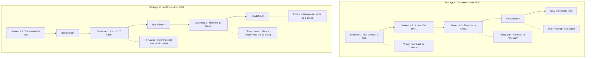

# EOS Token Placement: Document Boundaries vs Every Sentence

**Date:** October 2026  
**Builds On:** [2.pythia_followup_analysis.md](./2.pythia_followup_analysis.md)  
**Scope:** Why EOS is inserted at document/topic boundaries, and what would break if it were inserted after every sentence

---

## The Question

When I was studying the followup analysis and my notes, I understood that inserting special tokens (like `<|endoftext|>`) happens **before** tokenisation, during the data preprocessing step. The gist is:

> You insert the EOS token as per the context. For example, if the article is about cheetahs, you insert EOS once the article ends and then move on to the next topic. Since EOS serves as a breakpoint to tell the LLM when to stop: **what effect would it have inserting EOS this way (at document/topic boundaries) versus inserting EOS after the completion of every statement?**

---

## The Answer

### EOS Is Inserted at Document Boundaries, Not After Every Sentence

Looking at my notes and the `preprocess_data.py` code I examined in the followup analysis:

```python
if self.args.append_eod:
    doc_ids[-1].append(Encoder.tokenizer.eod)  # ONE EOS per document
```

The EOS token goes at the end of each **document**: a Wikipedia article, a web page, a code file, or a book chapter. It is not inserted after every sentence, and not after every paragraph.

---

## The Two Strategies Compared

### Strategy A: EOS at Document Boundaries (What Real LLMs Actually Do)

```
Stream: The cheetah is the fastest land animal. It can reach speeds of 
        120 km/h. They live in Africa and parts of Iran. <|endoftext|>
        Quantum computing uses qubits instead of classical bits. ...
```

The model sees the entire cheetah article as **one continuous context**. Every token can attend to every previous token within the same sequence window. The model learns:

- That "They" refers to cheetahs (coreference)
- That "Africa" is related to cheetah habitat (world knowledge)
- That sentences within a topic flow logically into each other (discourse coherence)
- That `<|endoftext|>` means "everything before this is one coherent unit, and everything after is unrelated"

### Strategy B: EOS After Every Sentence (Hypothetical: Nobody Does This)

```
Stream: The cheetah is the fastest land animal. <|endoftext|> It can 
        reach speeds of 120 km/h. <|endoftext|> They live in Africa 
        and parts of Iran. <|endoftext|> Quantum computing uses 
        qubits instead of classical bits. <|endoftext|> ...
```

This would be catastrophic for the model. Here is why:

---

## Why Sentence-Level EOS Breaks Everything

### 1. It Destroys Cross-Sentence Context

The model learns that after `<|endoftext|>`, the topic changes completely; it learns to "reset" its internal state (as I noted in `2.pythia_followup_analysis.md`, Section 2.2, Point 3). If you put EOS after every sentence, the model treats "It can reach speeds of 120 km/h" as completely unrelated to "The cheetah is the fastest land animal."

The word "It" at the start of sentence 2 is a pronoun that refers to "cheetah", but we have just told the model to forget everything before the EOS. The model can never learn coreference, anaphora, or multi-sentence reasoning.

### 2. You Lose Discourse Structure

Language has structure beyond individual sentences. Paragraphs build arguments. Articles have introductions, evidence, and conclusions. Books have narrative arcs. By inserting EOS between every sentence, you reduce the model to learning isolated sentence patterns, essentially turning a generative language model into a sentence-level classifier.

This is why BERT (which processes mostly sentence-level inputs) is great at classification but struggles at open-ended generation.

### 3. It Makes the EOS Token Meaningless

If EOS appears after literally every sentence, it carries zero unique information. It becomes identical to a period. The model has no way to distinguish between:
- "End of a thought within a topic" (what a period does)
- "End of the entire topic, new topic coming" (what EOS is supposed to do)

In contrast, when EOS only appears at document boundaries, it carries a strong signal: "reset everything, the next tokens are from a completely different context." This is what allows the model to know when to stop generating during inference.

### 4. It Cripples Long-Range Dependency Learning

Consider this passage:

> "In 1969, Armstrong became the first human to walk on the Moon. The mission, Apollo 11, launched from Kennedy Space Center. Twenty years later, President Bush proposed a return to the Moon."

The phrase "Twenty years later" requires the model to connect back to "1969" from two sentences ago. With sentence-level EOS, that connection is severed.

Modern LLMs are valuable specifically for their ability to track information across thousands of tokens. Sentence-level EOS throws that away entirely.

---

## The Real Tradeoff: Document Granularity

The interesting question is not sentence versus document. It is: **what counts as a "document"?**

| Granularity | What Gets an EOS | Effect |
|---|---|---|
| Entire book | EOS after 100K+ tokens | Model learns very long-range dependencies, but the EOS signal is extremely rare |
| **Article / web page** | **EOS after ~500-2000 tokens** | **The sweet spot, which is what most models use** |
| Paragraph | EOS after ~50-200 tokens | Model loses inter-paragraph coherence |
| Sentence | EOS after ~10-30 tokens | **Destroys everything**: the model cannot learn multi-sentence reasoning |

Most training corpora naturally define documents based on what the source provides:
- One Wikipedia article = one document
- One web page = one document
- One Reddit post = one document
- One code file = one document

The data pipeline (such as `preprocess_data.py` with `--append-eod`) simply respects those boundaries.

---

## Why Document-Level EOS Still Teaches the Model When to Stop

The initial concern I had was: *"since EOS serves as a breakpoint to tell the LLM when to stop"*, wouldn't it stop better if trained more often? 

In practice, document-level EOS is actually far better for this purpose.

During inference, when you prompt an LLM and it generates a response, you want it to stop at a natural completion point. If it learned EOS at document boundaries, the learned rule is:

> "Generate a complete, coherent response on a topic, then stop."

That is exactly what we want.

If it had learned EOS after every sentence, it would try to stop after generating a single sentence, making it useless for anything beyond one-liners.

---

## Visual Summary



---

## What the Model Learns in Each Case

| Capability | Document-Level EOS | Sentence-Level EOS |
|---|---|---|
| Coreference ("it", "they", "this") | Learns across sentences | Broken: reset kills the referent |
| Multi-sentence reasoning | Full context available | Each sentence is isolated |
| Discourse coherence (topic flow) | Learns how ideas connect | No connection between sentences |
| When to stop generating | Stops after a complete thought | Stops after one sentence |
| Meaning of EOS token | Strong signal: "topic change" | Weak signal: same as punctuation |
| Long-range dependencies | Can track info across paragraphs | Cannot look past last EOS |

> [!IMPORTANT]
> **The bottom line:** Inserting EOS at document/topic boundaries teaches the model two critical things simultaneously: (1) how to maintain coherent multi-sentence reasoning within a topic, and (2) that EOS means "this complete unit of thought is done." Inserting EOS after every sentence would destroy both capabilities. It is not a subtle difference; it produces a fundamentally broken model.

---

## References

| # | Source | Relevance |
|---|---|---|
| 1 | [2.pythia_followup_analysis.md](./2.pythia_followup_analysis.md) (Section 2.2) | Why the model learns to use `<\|endoftext\|>` as a reset signal |
| 2 | [2.pythia_followup_analysis.md](./2.pythia_followup_analysis.md) (Section 3.8) | The `preprocess_data.py` code showing one EOS per document |
| 3 | [claude.txt](./claude.txt) (Lines 123-129) | Stream and block example showing document boundaries |
| 4 | [Fewer Truncations Improve Language Modeling (Ding et al., ICML 2024)](https://arxiv.org/abs/2404.10830) | Measuring the cost of different packing strategies |
