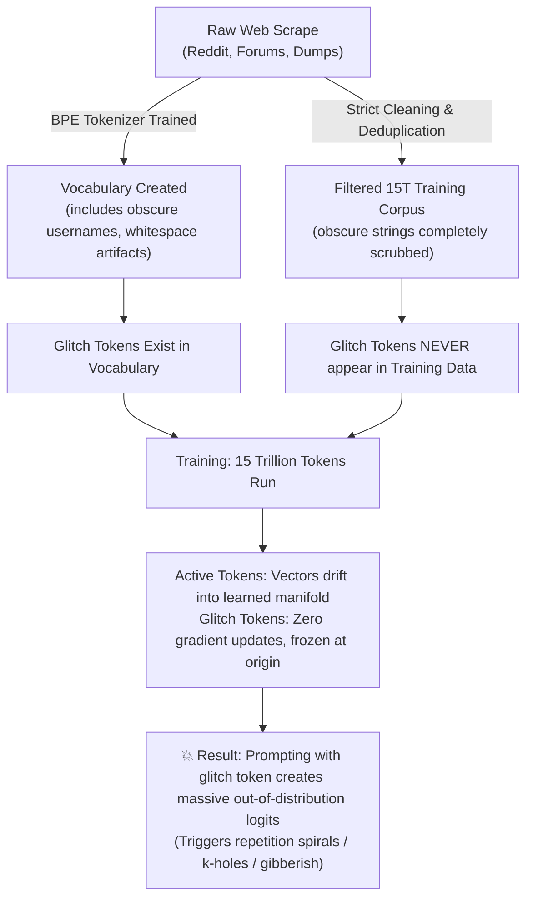

# The Role of Massive Scale: Tokenizer Artifacts, Glitch Tokens, and the Limits of RLHF

**Date:** October 2026  
**Builds On:** [2.pythia_followup_analysis.md](./2.pythia_followup_analysis.md), [3.eos_placement_analysis.md](./3.eos_placement_analysis.md)  
**Scope:** Examining whether 15T+ token scale is used as a brute-force sponge for tokenization errors, how glitch tokens and generation collapse (k-holes) actually arise, and why RLHF cannot compensate for base-model flaws.

---

## 1. The Core Question

> *Meta observed in the Llama 3 technical report that over 15+ trillion tokens, document masking produced only marginal gains on standard benchmarks because the sheer volume of data naturally taught the model that `<|end_of_text|>` functions as a reset barrier.*  
> 
> **Question:** Is this one of the many reasons why AI labs force themselves to train on massive corpora (10T–15T+ tokens)—to brute-force around edge cases like glitch tokens, generation collapse / k-holes, and boundary artifacts—while ignoring that models ultimately rely heavily on RLHF anyway?

---

## 2. The "Statistical Shock Absorber": Why Scale Hides Boundary Bleed

Meta's observation—that document masking barely mattered during standard pretraining—is a direct consequence of **gradient dilution**:

```
Small Run (100B tokens):
[ Doc A ... ] [ Doc B ... ]   <-- Arbitrary cross-document cuts make up a noticeable % 
                                  of gradient updates. Model memorizes spurious links.

Massive Run (15T tokens):
[ Doc A ... ] <|eot|> [ Doc B ... ]  <-- Model encounters reset signals hundreds of millions
                                         of times. Boundary noise becomes statistical dust.
```

* **In smaller models / runs (~100B tokens):** Cutting sentences mid-stream and letting Document $A$ bleed into Document $B$ makes up a tangible fraction of all training steps. The model actively assigns weight to spurious transitions across document boundaries.
* **At 15 Trillion tokens:** The model sees `<|end_of_text|>` hundreds of millions of times. It observes so many pure, coherent contexts that the gradient signal from arbitrary cross-document cuts is diluted into microscopic background noise.

**The Emergent Reset Mechanism:**  
The model essentially learns: *"Over billions of examples, tokens following `<|end_of_text|>` bear zero semantic relationship to tokens preceding it. I must route my attention into an internal sink to nullify previous context."*

For frontier labs, this created an engineering shortcut: *Why invest heavy engineering effort into complex variable-length data loaders for early pretraining when 15T tokens of compute automatically washes 95% of the boundary bleed away?*

---

## 3. The Glitch Token Paradox: Scale Actually Made It Worse

A common assumption is that training on 15T tokens also helps eliminate anomalies like **glitch tokens** (e.g., `SolidGoldMagikarp`, `StreamerBot`, ` petertodd` in GPT-based models).

In reality, **scale did not fix glitch tokens; scale created them.**



### Why Glitch Tokens Happen
1. **The Corpus Mismatch:** Tokenizers are trained on raw, unfiltered text dumps. But the actual text fed into the transformer is heavily cleaned, filtered, and deduplicated.
2. **Zero Gradient Updates:** If a token exists in the vocabulary table but is completely filtered out of the training corpus, its embedding vector receives **zero (or near-zero) gradient updates**.
3. **The Geometry Gap:** Over 15 trillion tokens, active token embeddings are repeatedly transformed and normalized into a compact semantic manifold. The dead glitch token stays frozen near its initialization state.
4. **The "K-Hole" Trigger:** When a user passes this token at inference, its anomalous vector geometry causes erratic dot-product scores in self-attention, outputting wild logits that throw the generation loop into an inescapable repetition loop or hallucinatory spiral.

> **How modern labs actually fixed this:**  
> Not through scale, but through **tokenizer hygiene**:
> - Enforcing strict minimum token frequency cutoffs during tokenizer creation.
> - Pruning unused tokens from the embedding matrix.
> - Adopting byte-fallback tokenizers (e.g., Tiktoken, SentencePiece byte-level) so obscure words decompose into known subwords or raw bytes rather than dedicated tokens.

---

## 4. The "RLHF Illusion": Why Post-Training Cannot Fix Base-Model Sins

It is tempting to think: *"If the pretraining corpus has messy cuts and hallucinations, doesn't RLHF fix it all in post-training?"*

Research into the **Surface Form Hypothesis** (formalized by Meta's [LIMA Paper](https://arxiv.org/abs/2305.11206)) shows this is fundamentally mistaken:

```
┌────────────────────────────────────────────────────────┐
│ Pre-training (15+ Trillion Tokens):                    │
│ Learns 99% of knowledge, grammar, logic, and world     │
│ representation.                                        │
│ (The structural engine of the vehicle)                 │
└───────────────────────────┬────────────────────────────┘
                            │
┌───────────────────────────▼────────────────────────────┐
│ SFT + RLHF / DPO (A few million to billion tokens):    │
│ Learns stylistic tone, safety boundaries, formatting,  │
│ and conversational personas.                           │
│ (The paint job, steering wheel, and dashboard)         │
└────────────────────────────────────────────────────────┘
```

### Why RLHF Fails to Compensate for Base-Model Flaws:
1. **RLHF Cannot Synthesize Missing Knowledge:** RLHF adjusts token emission probabilities; it cannot insert knowledge that was never encoded into the weights. If a model was confused by cross-document leakage during pretraining, RLHF cannot untangle that conceptual blur.
2. **The Sycophancy / Confident Hallucination Trap:** Applying RLHF to a foundation model with weak or contaminated representations often trains the model to *sound authoritative and persuasive while being factually wrong*.
3. **Jailbreaks Strip the Alignment Layer:** Jailbreaking prompts, temperature alterations, or adversarial attacks peel back the thin RLHF probability bias. What remains underneath is the raw pre-trained distribution. If that distribution contains structural anomalies, the model immediately destabilizes into degenerate output.

**Why Meta Made Document Masking Mandatory in Late Stages:**  
Meta explicitly enforced document masking during **long-context extension (8K → 128K)** and **Supervised Fine-Tuning (SFT)** because in those stages, cross-document leakage directly breaks instruction-following precision.

---

## 5. The Real Driver Behind 15T+ Tokens: The Economics of "Overtraining"

If 15T tokens is not strictly about smoothing over tokenizer quirks, why did Meta train Llama 3 8B on **15 Trillion tokens** when classical scaling laws (Chinchilla) suggested it was completely unnecessary?

The answer lies in **Inference Economics**:

| Paradigm | Chinchilla Optimal (Hoffmann et al., 2022) | Inference-Optimal "Overtraining" (Llama 3, 2024) |
|---|---|---|
| **Core Objective** | Minimize compute budget ($FLOPs$) needed to train a model to a target loss | Minimize **serving and latency costs** over billions of user queries |
| **Tokens for an 8B Model** | ~160 Billion – 200 Billion tokens | **15+ Trillion tokens** (~75× past Chinchilla limit) |
| **Tradeoff** | Model stops training early; needs a massive 70B model to reach high intelligence | High upfront training cost, but yields an 8B model that rivals older 70B models |
| **Operational Cost** | Expensive to host; requires multi-GPU clusters for serving | Runs on a single cheap consumer GPU / edge device |

Frontier labs overtrain small parameter counts because **training compute is paid once, but inference serving is paid every millisecond forever**.

---

## 6. Summary: What Scale Does (and Doesn't) Do

| Phenomenon | Does 15T Token Scale Solve It? | The Actual Reality |
|---|---|---|
| **Cross-Document Bleed** | **Yes (Mostly)** | Gradient dilution washes away boundary noise; the model treats `<\|end_of_text\|>` as a hard reset barrier. |
| **Glitch Tokens** | **No (Exacerbates it)** | Unused vocabulary tokens remain frozen at initialization while active embeddings drift, widening the geometric anomaly. Fixed by tokenizer sanitation. |
| **Repetition Loops ("K-Holes")** | **Partially** | Better logit calibration reduces premature collapse, but attention sinks and architectural guards are still necessary. |
| **Reliance on RLHF** | **No (Independent)** | RLHF is cosmetic steering. A flawed, contaminated base model will still hallucinate and fail under adversarial prompting. |
| **Small Model Capability** | **Yes (Primary reason)** | Enables extreme compression of world knowledge into small parameter architectures (8B), drastically lowering per-token inference cost. |

---

## 7. Key References & Further Reading

1. **[The Llama 3 Herd of Models (Meta AI, 2024)](https://arxiv.org/abs/2407.21783)**  
   *Sections 3.4 & 3.4.2:* Detailed discussion of sequence packing, 4D document masking, and the transition from 8K to 128K context.
2. **[Fewer Truncations Improve Language Modeling (Ding et al., Amazon Science, ICML 2024)](https://arxiv.org/abs/2404.10830)**  
   *Benchmark study:* Quantifies the hallucination rate (up to 58% increase) caused by cross-document attention leakage in naive sequence packing.
3. **[LIMA: Less Is More for Alignment (Zhou et al., Meta AI, 2023)](https://arxiv.org/abs/2305.11206)**  
   *The Surface Form Hypothesis:* Demonstrates that pretraining teaches almost all knowledge, while post-training (RLHF/SFT) primarily controls style and formatting.
4. **[Training Compute-Optimal Large Language Models (Hoffmann et al., DeepMind, 2022)](https://arxiv.org/abs/2203.15556)**  
   *Chinchilla Scaling Laws:* Establishes the relationship between parameter count and token volume, providing the baseline that modern "overtraining" intentionally breaks.
