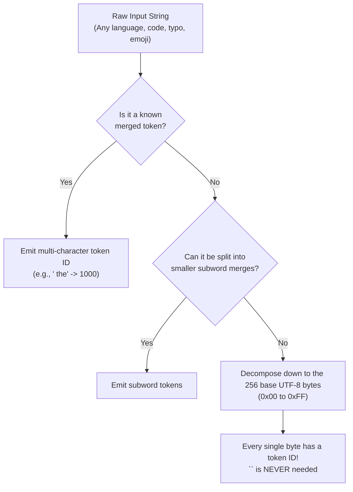

# The `<unk>` Paradox: Why 404-Style Handling Fails to Prevent Glitch Tokens

**Date:** October 2026  
**Builds On:** [4.scale_overtraining_and_glitch_tokens.md](./4.scale_overtraining_and_glitch_tokens.md), [2.pythia_followup_analysis.md](./2.pythia_followup_analysis.md)  
**Scope:** Explaining why the unknown token (`<unk>`) is not triggered by glitch tokens, why modern LLMs rarely emit `<unk>`, and why a 404-style error handling paradigm does not work for neural language models.

---

## 1. The Question

A question I found myself asking while investigating glitch tokens was:

> *Tokenizers have an `<unk>` token. If the system simply displayed a "404 Not Found" error when encountering an anomalous or unfamiliar token, shouldn't that in theory eliminate glitch tokens and generation collapse? Why does this issue still happen in production models?*

---

## 2. The Core Irony: The Tokenizer Was *Too* Confident

What surprised me when I looked into the mechanics is that glitch tokens (like `SolidGoldMagikarp`, `StreamerBot`, or ` petertodd` in GPT-based models) do **not** happen because the tokenizer encountered an unknown word.

It happens because of the exact opposite: **the tokenizer had a dedicated single token for it.**

```
What a developer expects (Safe Fallback):
User types:  "SolidGoldMagikarp"
Tokenizer:   "I don't know this word -> Split into subwords ['Solid', 'Gold', 'Magi', 'karp'] or raw bytes"
Model:       Has trained embeddings for each piece -> Understands prompt safely

What ACTUALLY happened (The Glitch):
User types:  "SolidGoldMagikarp"
Tokenizer:   "I know this exact string! It's a single token: Token ID #42089!"
Model:       "Wait... Token #42089 received zero updates during my 15T-token training run..."
```

Because the tokenizer successfully matched `"SolidGoldMagikarp"` to `Token ID 42089`, **no `<unk>` token was ever generated.** From the perspective of the tokenizer, this was a completely valid, recognized entry in its lookup table.

---

## 3. The Extinction of `<unk>` in Modern LLMs (Byte-Level BPE)

In older NLP models (like BERT, which used WordPiece), tokenizers had fixed vocabularies. If a word was not present and could not be assembled from known subwords, it was replaced with `[UNK]`. This caused severe degradation whenever users inputted emojis, non-English scripts, or code snippets, turning them into strings of `[UNK] [UNK] [UNK]`.

Starting with **GPT-2**, modern LLMs (GPT-4, Llama 2/3, Mistral, Qwen, Claude) switched to **Byte-Level Byte-Pair Encoding (Byte-level BPE)**:



* The base vocabulary contains all **256 possible bytes** of UTF-8.
* Any character sequence on earth can be broken down into individual bytes.
* **Modern LLM tokenizers literally cannot encounter an unknown character.** Even if `<unk>` is listed in the tokenizer config file for legacy backward compatibility, the encoding algorithm practically **never emits it**.

---

## 4. The Architectural Disconnect: Tokenizer vs. Neural Network

A critical architectural insight I gained is that **the tokenizer and the neural network are two completely decoupled systems** running independently:

```
[ User Input Prompt ]
         │
         ▼
┌─────────────────────────────────┐
│ 1. Tokenizer (Deterministic C++)│  --> Performs greedy dictionary lookup.
│                                 │      "Found exact match! Emitting ID 42089."
└────────────────┬────────────────┘
                 │ (Passes pure integers, e.g. [42089])
                 ▼
┌─────────────────────────────────┐
│ 2. Embedding Matrix (PyTorch)   │  --> Looks up Row 42089 of weights table.
│    W_emb: (vocab_size, d_model) │      Row 42089 was NEVER trained (received 0 gradients).
└────────────────┬────────────────┘      Contains random initialization vectors!
                 │
                 ▼
┌─────────────────────────────────┐
│ 3. Self-Attention Layers        │  --> Dot products with un-normalized, stray vectors
│                                 │      explode attention weights into extreme logits.
└────────────────┬────────────────┘
                 │
                 ▼
┌─────────────────────────────────┐
│ 4. Auto-regressive Generation   │  --> Model enters repetitive degenerations,
│                                 │      hallucination spirals, or crashes ("k-holes").
└─────────────────────────────────┘
```

At the inference layer, the GPU only sees the integer `42089`. To the model weights, it looks indistinguishable from `1000` (the token for `" the"`). The runtime has no native way of knowing that row `42089` represents an undertrained token.

---

## 5. Why a "404 Error" Cannot Work in Practice

Why not simply build a safeguard that inspects tokens and throws an exception or 404 response?

### A. A 404 Breaks the Foundational Value of an LLM
The primary strength of generative language models is their ability to gracefully handle unstructured, chaotic human communication. If an LLM threw a 404 error whenever it encountered an unfamiliar string, it would fail on:
* Common typos and misspelled words (`"recieved"`, `"definately"`)
* Proprietary variable names in programming code (`"user_auth_v2_temp"`)
* New slang, memes, or domain-specific jargon
* Foreign words and unicode symbols

### B. Neural Networks Do Not Throw Exceptions
A transformer is a continuous mathematical function mapping tensor inputs to a probability distribution across the vocabulary. It does not contain `try/catch` logic. When its attention calculation is poisoned by an untrained vector, it does not fail with an error code; it outputs high-probability nonsense.

### C. The Detection Problem at Runtime
To intercept a glitch token at inference, you would need to know in advance which token IDs are glitched. But there is no obvious flag in the vocabulary metadata that says: `"Warning: this token was never seen during pretraining."`

---

## 6. How Frontier Labs Actually Solved This

Because runtime 404 exceptions are infeasible, modern frontier labs address the issue during the **data engineering and tokenizer creation** phase:

| Phase | Historical Approach (GPT-2 / GPT-3) | Modern Frontier Approach (Llama 3 / Qwen 2.5) |
|---|---|---|
| **Tokenizer Training Corpus** | Trained on raw, uncleaned web scrapes (contained Reddit usernames, code fragments). | Trained on a carefully sampled, representative slice of the **cleaned, deduplicated pretraining data**. |
| **Minimum Frequency Cutoff** | Included rare strings that appeared only a handful of times in raw data. | Imposes strict minimum occurrence thresholds (such as requiring tokens to appear thousands of times across diverse sources). |
| **Vocabulary Pruning** | Retained dead tokens in the embedding table even if pretraining filters scrubbed them. | Audits the gradient log after pretraining; strips unused token rows or resets their embeddings. |
| **Fallback Strategy** | Allowed obscure 15-character strings to become single monolithic tokens. | Enforces subword and byte-fallback decomposition so rare strings decompose into familiar, heavily-trained pieces. |

---

## Summary Takeaways

* `<unk>` fails to catch glitch tokens because the tokenizer **already knew the word** and assigned it a dedicated token ID.
* Modern tokenizers use **Byte-Level BPE**, making `<unk>` obsolete since any string can be decomposed down into raw bytes.
* A 404 error model contradicts the fundamental purpose of an LLM, which is to parse arbitrary, noisy human input without crashing.
* Glitch tokens are solved by **tokenizer hygiene and vocabulary pruning before training**, not runtime exception handling.
