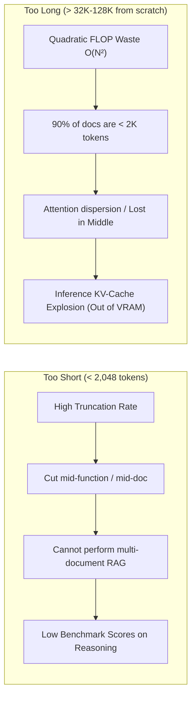
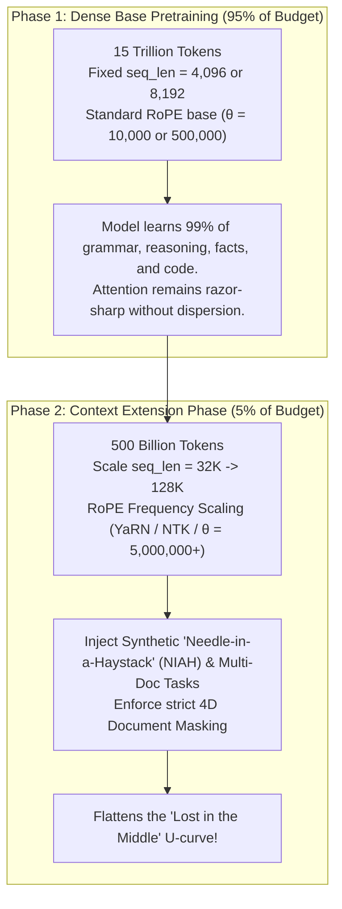

# Context Window vs. Max Tokenized Length: The "Lost in the Middle" Dilemma and the Ideal Sequence Length

**Date:** October 2026  
**Builds On:** [1.pythia_tokenisation_analysis.md](./1.pythia_tokenisation_analysis.md), [2.pythia_followup_analysis.md](./2.pythia_followup_analysis.md), [3.eos_placement_analysis.md](./3.eos_placement_analysis.md), [4.scale_overtraining_and_glitch_tokens.md](./4.scale_overtraining_and_glitch_tokens.md), [5.why_unk_and_404_fail_for_glitch_tokens.md](./5.why_unk_and_404_fail_for_glitch_tokens.md)  
**Scope:** Analyzing the distinction between training sequence length and inference context window, why the "Lost in the Middle" U-shaped curve occurs, why both short and huge context windows break, and what the industry-standard "ideal" sequence length is.

---

## 1. Disambiguation: Max Tokenized Length vs. Context Window

When I started digging into how models are trained versus how they are evaluated, I had to separate two concepts that are constantly conflated in casual discussion:

| Concept | What It Actually Is | Typical Values | Where It Is Enforced |
|---|---|---|---|
| **Max Tokenized Length (`max_seq_len` / Block Size)** | The fixed chunk size sliced during **training**. Documents are concatenated, packed, and sliced into tensor rows of this exact dimension. | 2,048 (Pythia/GPT-3)<br>4,096 (Llama 2)<br>8,192 (Llama 3) | Training data loader / DataLoader batch tensor: `(batch_size, max_seq_len)` |
| **Inference Context Window (`max_position_embeddings`)** | The maximum span of continuous tokens the model's attention mechanism can ingest and attend across during **inference**. | 8K, 32K, 128K, up to 1M-2M (Gemini) | Model architecture config / Positional embedding scheme (RoPE) |

### The Historical Pattern vs. The Modern Pattern
* **Historically (2019-2023):** `Training seq_len == Context Window`. (GPT-2 trained on 1,024, evaluated on 1,024. Pythia trained on 2,048, evaluated on 2,048).
* **Modern Frontier (2024+):** `Training seq_len < Context Window`. Models train 95%+ of their tokens on a modest block size (such as 4,096 or 8,192), and then use a short **continued context-extension stage** (plus RoPE frequency scaling) to stretch the inference window to 32K or 128K+.

---

## 2. Deconstructing "Lost in the Middle" (Liu et al., 2023)

When I read the seminal paper **["Lost in the Middle: How Language Models Use Long Contexts"](https://arxiv.org/abs/2307.03172)** (Liu et al.; Stanford & Meta), one empirical finding stood out: language model performance does not degrade linearly as contexts grow. Instead, it forms an aggressive **U-shaped curve**:

```
Model Accuracy
  100% ┤  ███                                            ███
       │  ███                                            ███   <-- High accuracy at edges
       │  ███                                            ███       (Primacy & Recency)
   50% ┤   ███                                          ███
       │    ███                                        ███
       │     ███                                      ███
       │      ████                                  ████
   20% ┤        ████████                      ████████
   10% ┤               ████████████████████████                <-- Massive Valley of Death
       └─────────────────────────────────────────────────────      (Lost in the Middle)
        Start of Context         Middle of Context        End of Context (Recent)
        (Token 0 ... 500)       (Token 4,000 ... 12,000)   (Token 15,500 ... 16,000)
```

### Why Does the Model Lose the Middle?

In my analysis, the "Lost in the Middle" phenomenon stems from three interacting mechanisms:

#### 1. Attention Sinks & Primacy Bias
Because autoregressive causal transformers use a left-to-right mask, the first few tokens (Token 0, Token 1) are attended to by **every single subsequent token** in the entire sequence. As proven in the *StreamingLLM* paper (Xiao et al., 2023), early tokens naturally absorb huge amounts of unallocated attention weight ("attention sinks"). The model naturally over-indexes on the beginning of the prompt.

#### 2. Recency Bias (Causal Proximity)
Tokens closest to the query (the very end of the input sequence) have the strongest local activations and benefit from immediate recency in causal masking.

#### 3. Relative Positional Decay (RoPE)
Modern models use **Rotary Position Embeddings (RoPE)**. In RoPE, the dot-product of query and key decays as relative distance $|m - n|$ grows. While this prevents distant noise from overwhelming local syntax, it also means that tokens deep in the middle of a 32K or 128K context experience high distance attenuation relative to both the initial prompt and the final generation query.

---

## 3. The Two Extremes: Why Both Too Short and Too Long Fail

Looking at sequence length choices, two distinct failure modes emerge:
* **Too short** degrades evaluations and context capability.
* **Too long** loses information in the middle and wastes catastrophic amounts of compute.



### Problem A: Why "Too Short" (< 2,048 tokens) Fails
1. **Severe Truncation Penalty:** As demonstrated in the Amazon *Fewer Truncations* paper (Ding et al., 2024), cutting documents at 1,024 or 2,048 tokens chops code files, legal agreements, and articles into disconnected fragments. The model never learns multi-hop reasoning across sections.
2. **Useless for Modern Workloads:** Real-world applications require passing system instructions, user personas, chat histories, and retrieved RAG chunks. A 2,048-token context is saturated before the user even finishes asking their question.
3. **Loss of Coherence:** The model's internal representations never learn to track state variables, narrative arcs, or dependencies across long horizons.

### Problem B: Why "Too Long" (64K-128K) from Step 0 Fails
1. **The FLOP Cost of Attention is Quadratic $O(N^2)$:**  
   Doubling sequence length from 4K to 8K quadruples the attention matrix size. Jumping from 4K to 64K increases attention compute by a factor of **256x**. Even with FlashAttention-2, training an entire 15-trillion-token run at 64K would consume billions of dollars in redundant compute.
2. **Natural Data Distribution Is Short:**  
   Empirical studies of the web (Common Crawl, Wikipedia, Reddit, GitHub) reveal that **over 85-90% of natural text documents contain fewer than 2,500 tokens**. If your training block is 64,000 tokens long, you are packing 25 to 30 unrelated documents together in every single row. Even with document masking, the model spends most of its FLOP budget computing attention over arbitrary packed mixtures rather than dense semantic reasoning.
3. **Severe Attention Dispersion:**  
   Softmax attention sums to $1.0$:
   $$\text{Attention}(Q, K) = \text{softmax}\left(\frac{QK^T}{\sqrt{d_k}}\right)$$
   When the denominator has 64,000 keys instead of 4,000 keys, the probability distribution is spread across a massive ocean of tokens. Unless the model is trained with explicit long-dependency retrieval incentives, the probability mass assigned to critical middle tokens drops close to zero, triggering the "Lost in the Middle" collapse.
4. **Inference Memory Wall:**  
   At inference, the KV cache scales linearly with sequence length:
   $$\text{KV Cache Size} = 2 \times \text{layers} \times \text{heads} \times \text{dim} \times \text{seq\_len} \times \text{bytes}$$
   Serving a 128K context to multiple concurrent users exhausts GPU VRAM almost instantaneously without expensive optimizations like Multi-Head Latent Attention (MLA) or PagedAttention.

---

## 4. What Is the Ideal Training Sequence Length?

Across frontier AI labs (Meta, Mistral, Qwen, DeepSeek), an **industry consensus sweet spot** has emerged for initial pretraining:

> **The Ideal Base Pretraining Sequence Length: 4,096 to 8,192 Tokens.**

### Why 4K-8K Is the Empirical Sweet Spot:

| Metric / Dimension | 2,048 Tokens (Old Standard) | 4,096 - 8,192 Tokens (Modern Sweet Spot) | 32,768+ Tokens (Too High for Base) |
|---|---|---|---|
| **Document Coverage** | Covers ~65% of web documents completely | **Covers ~92-96% of web & code documents without a single cut** | Covers 99.9% of documents (diminishing returns) |
| **Quadratic Attention FLOPs** | Minimal | **Manageable (fits cleanly in SRAM via FlashAttention on H100)** | Explodes (requires complex multi-node context parallelism) |
| **"Lost in the Middle" Susceptibility** | Very Low | **Low (Attention remains sharp across the entire span)** | Very High (requires specialized NIAH training) |
| **Dense Syntax & Logic Acquisition** | Good | **Optimal (Captures complete classes, algorithms, essays)** | Diluted across excessive padding/packed documents |

---

## 5. The Modern Two-Stage Solution: How Frontier Labs Beat the Tradeoff

Modern LLMs don't pick one static number. Instead, they decouple **knowledge acquisition** from **long-context generalisation** using a **two-phase curriculum**:



### Step 1: Base Pretraining at 4K or 8K (95% of Tokens)
* The model trains on 10T-15T tokens with `seq_len = 8,192` (like Llama 3).
* This provides enough room to capture full code files, Wikipedia pages, and essays intact with minimal truncation, while keeping GPU attention memory completely inside high-speed GPU SRAM.

### Step 2: Context Extension Phase (Final 1-5% of Tokens)
* Labs take the fully trained base model and train it for only a few hundred billion tokens at **128,000 tokens**.
* They modify the RoPE base frequency $\theta$ (for instance, Llama 3 raised $\theta$ from 10,000 to **500,000**; Qwen raised it even further) or use **YaRN (Yet another RoPE extensioN)**.

### Step 3: Flattening the U-Curve with Synthetic NIAH
To fix the "Lost in the Middle" problem during Phase 2, labs deliberately construct synthetic datasets:
* **Needle in a Haystack (NIAH):** A random specific fact ("The secret passcode is 84920") is inserted at random depth percentiles (10%, 25%, **50%**, 75%, 90%) inside a massive 128K document dump.
* The model is forced to predict queries that retrieve the fact from the exact midpoint of the document.
* By backpropagating through millions of NIAH examples at the end of training, the model learns to maintain uniform attention across all positions, actively suppressing the U-shaped drop.

---

## 6. Practical Rules of Thumb for Builders

If you are designing, training, or fine-tuning models, here are the practical guidelines I follow:

1. **For Base Training / SFT:** Keep your training block size between **4,096 and 8,192 tokens**. Anything shorter hurts complex reasoning; anything larger wastes compute on uninformative empty context.
2. **Prompt Engineering to Beat "Lost in the Middle":**
   * **Place critical instructions at the top** (System Prompt / Context setup).
   * **Place the primary question/query and output format at the very bottom** (after all retrieved text).
   * **Never bury crucial instructions or constraints in the middle** of retrieved RAG documents.
3. **If using RAG (Retrieval-Augmented Generation):**
   * Re-rank your retrieved chunks so that the **most relevant chunk** is placed either at the very beginning or at the very end of the prompt window, not sandwiched in chunk #5 out of #10.

---

## References

| # | Paper | Key Contribution |
|---|---|---|
| 1 | **[Lost in the Middle: How Language Models Use Long Contexts (Liu et al., 2023)](https://arxiv.org/abs/2307.03172)** | Identified the U-shaped accuracy curve and retrieval failure in mid-context. |
| 2 | **[Fewer Truncations Improve Language Modeling (Ding et al., ICML 2024)](https://arxiv.org/abs/2404.10830)** | Proved why short sequence lengths (<2K) cause truncation errors and hallucination. |
| 3 | **[Efficient Streaming Language Models with Attention Sinks (Xiao et al., 2023)](https://arxiv.org/abs/2309.17453)** | Discovered why initial tokens absorb outsized attention weights (Attention Sinks). |
| 4 | **[The Llama 3 Herd of Models (Meta AI, 2024)](https://arxiv.org/abs/2407.21783)** | Documented the 8K base pretraining to 128K long-context extension recipe with RoPE $\theta=500,000$. |
| 5 | **[YaRN: Efficient Context Window Extension of Large Language Models (Peng et al., 2023)](https://arxiv.org/abs/2309.00071)** | Provided mathematical scaling of RoPE frequencies to prevent out-of-distribution positional collapse. |
