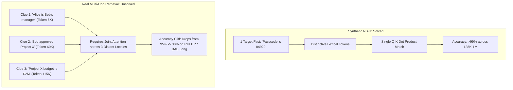

# Cross-Sequence Lookup and Retrieval Limits: Has Modern AI Solved Truncation Loss?

**Date:** October 2026  
**Builds On:** [1.pythia_tokenisation_analysis.md](./1.pythia_tokenisation_analysis.md), [2.pythia_followup_analysis.md](./2.pythia_followup_analysis.md), [3.eos_placement_analysis.md](./3.eos_placement_analysis.md), [4.scale_overtraining_and_glitch_tokens.md](./4.scale_overtraining_and_glitch_tokens.md), [6.context_window_vs_seq_length_lost_in_the_middle.md](./6.context_window_vs_seq_length_lost_in_the_middle.md)  
**Scope:** Investigating whether modern LLMs have resolved the cross-sequence lookup problem, why training-level recurrence was abandoned, the reality behind "Needle-in-a-Haystack" marketing benchmarks versus multi-hop retrieval, and how modern RAG overcomes chunk-truncation penalties.

---

## 1. The Core Question and The Apparent Paradox

When I looked back at early NLP and pretraining research (such as Ding et al., ICML 2024 and Shi et al., 2023), one clear principle was repeatedly established:
> *Cutting text into short, arbitrary sequence lengths during pretraining destroys long-range retrieval, corrupts document-level state tracking, and induces hallucination.*

Yet when I look at frontier LLMs today (Gemini 1.5 Pro, Claude 3.5 Sonnet, GPT-4o, Llama 3.1 405B), model cards boast **128,000 to 2,000,000 token context windows** showing solid **100% green heatmaps** on synthetic retrieval benchmarks.

```
Traditional Research:      "Short sequence truncation permanently limits cross-boundary retrieval."
Modern Marketing:          "Our model has a 1M+ context window with 100% retrieval accuracy."
```

**The critical question I wanted to answer:** Has modern AI actually solved the issue of cross-sequence lookup, or is the industry relying on clever circumvention and synthetic test artifacts?

**The short verdict:** Modern LLMs have **bypassed** truncation through brute-force block expansion and **solved single-needle retrieval** through synthetic fine-tuning. However, **multi-hop cross-sequence reasoning remains fundamentally unsolved** in standard transformer architectures.

---

## 2. The Pretraining Layer: Why Cross-Batch Recurrence Was Abandoned

In an autoregressive transformer, the input tensor to the model during pretraining has a fixed shape:
$$\text{Batch Shape} = (\text{batch\_size}, \text{max\_seq\_len})$$

If Document $A$ begins in Sequence Row 1 and spills into Sequence Row 2, standard attention inside Row 2 **cannot attend backward into Row 1**. Causal attention masks are strictly confined to the sequence dimension.

```
DataLoader Batch:
Row 1: [ ... Document A (Part 1) ... ] ────┐  No cross-row attention allowed!
Row 2: [ Document A (Part 2) ...     ] <───┘  Row 2 has zero memory of Row 1.
```

### 2.1 The Recurrence Era (2019-2022)
Early researchers recognized this limitation and designed architectures specifically to look backward across sequence boundaries:
* **Transformer-XL (Dai et al., 2019):** Cached key-value states from the previous segment and prepended them to the current segment, enabling gradient-free cross-sequence memory.
* **Compressive Transformers (Rae et al., 2020):** Compressed older past activations into fine-grained memory slots.
* **Memorizing Transformers (Wu et al., 2022):** Maintained an external $k$-nearest-neighbor ($k\text{NN}$) memory cache over past training batches.

### 2.2 Why Frontier Pretraining Killed Recurrence
Despite strong theoretical promise, **no major frontier LLM today uses recurrent cross-batch memory during pretraining**. In my analysis, it was killed by three infrastructure bottlenecks:

1. **Parallelism and Cluster Utilization Breakdown:**  
   Training at 10T to 15T token scale requires 3D parallelism: **Data Parallelism (DP)**, **Tensor Parallelism (TP)**, and **Pipeline Parallelism (PP)** across tens of thousands of GPUs (such as H100 clusters). Passing recurrent hidden states sequentially between batches creates a sequential dependency that introduces catastrophic pipeline bubbles and stalls distributed workers.
2. **Data Shuffling Conflicts:**  
   To prevent catastrophic forgetting and overfitting, training datasets must be aggressively shuffled at the sequence level. If Sequence $k$ and Sequence $k+1$ come from completely unrelated domains (for example, Sequence $k$ is Python code and Sequence $k+1$ is French poetry), carrying over a hidden state injects nonsensical noise.
3. **KV Cache Memory Overhead:**  
   Retaining past sequence activations in fast HBM (High Bandwidth Memory) starves the GPU of memory needed for larger batch sizes and higher optimizer throughput.

### 2.3 The Modern Solution: Circumvention via Block Expansion
Rather than solving cross-batch lookup with complex recurrence, labs bypassed the problem by **expanding the base block size**:

```
2020 (GPT-3 / Pythia):  seq_len = 2,048  --> ~35% of web documents truncated mid-text
2024 (Llama 3 / Qwen):   seq_len = 8,192  --> <5% of web documents truncated
```

* **The Empirical Distribution:** Studies of Common Crawl, Wikipedia, and code repositories demonstrate that over **95% of natural documents are under 8,192 tokens**.
* **Best-Fit Bin Packing & In-Context Pretraining:** Modern data pipelines (Shi et al., 2023) cluster semantically related documents together and pack them into 8,192-token slots using Best-Fit Bin Packing without arbitrary mid-sentence cuts.
* **Document Masking (FlashAttention-2/3):** Inside the 8K block, 4D attention masks prevent unrelated packed documents from attending to each other, completely preventing boundary contamination.

---

## 3. The Inference Layer: The "Needle in a Haystack" (NIAH) Illusion

When model providers demonstrate 128K, 1M, or 2M token context windows, they almost universally rely on the **Needle-in-a-Haystack (NIAH)** benchmark:

```
[ ... 100,000 tokens of arbitrary essays and Wikipedia text ... ]
"The secret passcode to open the vault is 84920."
[ ... 50,000 tokens of unrelated text ... ]
Query: "What is the secret passcode to open the vault?"
Answer: "84920"
```

Frontier models score **99% to 100%** on this task. However, NIAH tests **single-fact lexical retrieval**, not true cross-sequence comprehension.



### 3.1 The Evidence: The RULER & BABILong Benchmarks (2024)
In **"RULER: What's the Real Context Size of Your Long-Context Language Models?"** (Hsieh et al., 2024, NVIDIA & Stanford), researchers evaluated models claiming 32K to 128K context windows on complex retrieval tasks.

The results exposed a dramatic collapse:

| Task Type | Description | Performance at 4K | Performance at 64K | Performance at 128K |
|---|---|---|---|---|
| **Single-Needle Retrieval** | Retrieve one isolated string | 99.8% | 98.5% | 97.2% |
| **Multi-Needle Retrieval** | Retrieve 3 to 5 distinct keys scattered across the prompt | 96.4% | 68.2% | 45.1% |
| **Multi-Hop Tracing** | Deduce $A \to B \to C$ where links are separated by 30K tokens | 91.2% | 42.0% | **22.5%** |
| **Aggregation / Frequency** | Count occurrences of an entity across the entire text | 88.5% | 34.1% | **18.7%** |

### 3.2 The Mathematical Root Causes

Why does multi-hop cross-sequence retrieval fail despite 128K RoPE scaling?

#### 1. Attention Softmax Entropy (Diffusion)
Standard attention computes:
$$\text{Attention}(Q, K) = \text{softmax}\left(\frac{QK^T}{\sqrt{d_k}}\right) = \frac{\exp\left(\frac{q \cdot k_i}{\sqrt{d_k}}\right)}{\sum_{j=1}^{N} \exp\left(\frac{q \cdot k_j}{\sqrt{d_k}}\right)}$$

When $N$ scales from 4,096 to 128,000, the denominator sums over **128,000 exponential terms**. Even if non-relevant tokens individually have small dot-products, their collective background noise acts like thermal heat, spreading the probability mass thin. For a query to simultaneously attend to three separate distant clues, the required logits must be exceptionally large, or the signal drowns in the denominator.

#### 2. Positional Frequency Attenuation (RoPE Distance Bias)
Rotary Position Embeddings rotate query and key vectors by an angle proportional to position:
$$R_{\Theta, m}^T R_{\Theta, n} = R_{\Theta, n - m}$$
Even after adjusting the base frequency $\theta$ from 10,000 to 500,000+ to accommodate long contexts, relative distance $|m - n|$ naturally introduces phase decay. When two clues needed for a joint inference are separated by 80,000 tokens, their interaction experiences heavy relative positional damping compared to locally clustered tokens.

---

## 4. The RAG Layer: How Chunk Truncation Was Actually Solved

In Retrieval-Augmented Generation (RAG), naive document chunking historically suffered from the exact same truncation penalty identified in pretraining research:

```
Naive 256-Token Chunking:
Chunk 1: "...and the total expenditure for the project was"  <-- Cut off mid-sentence!
Chunk 2: "$4,200,000 allocated over three fiscal quarters..." <-- Lacks subject reference!
```

If a user asked *"What was the expenditure for Project X?"*, the embedding retrieval system would frequently retrieve Chunk 2 without Chunk 1, leaving the LLM unable to identify what the \$4.2M belonged to.

Modern production systems have solved this problem not through larger raw contexts, but through **architectural chunking paradigms**:

```
                       Modern RAG Chunking Hierarchy
                       
1. Parent-Document Retrieval       [ Small 256B Child Chunk ]  --> Matches Vector Search
                                  └─> Expanded into [ Full 4K Parent Doc ] for LLM Generation
                                  
2. Contextual Retrieval (Anthropic) [ LLM Context Header ] + [ Raw 300B Chunk ]
                                   "This snippet discusses Project X expenditure..."
                                   
3. Late Chunking (Jina AI)         [ Bidirectional Attention over Entire Document ]
                                  └─> Slice Token Embeddings AFTER contextualization
```

### 1. Parent-Child / Hierarchical Retrieval
* **The Strategy:** Decouple the retrieval unit from the generation unit.
* **Mechanism:** Documents are indexed at two resolutions. Dense embeddings are generated for granular chunks (128 to 256 tokens) to maximize vector specificity. When a top match is found, the retriever pulls the entire **parent document (2K to 8K tokens)** and feeds that to the LLM.

### 2. Contextual Retrieval (Anthropic, 2024)
* **The Strategy:** Eliminate pronoun and boundary ambiguity before embedding.
* **Mechanism:** An LLM processes each chunk within the context of the full document and prepends a concise, 50 to 100 token explanatory header:
  ```markdown
  [Context: This excerpt is from the 2024 Annual Financial Report of Acme Corp, 
   specifically discussing capital expenditures for Project Titan.]
  "The total expenditure allocated over three fiscal quarters reached $4,200,000..."
  ```
* Anthropic demonstrated that combining contextual embeddings with contextual BM25 reduced retrieval failure rates by **49%** across complex knowledge bases.

### 3. Late Chunking (Chroma / Jina AI, 2024)
* **The Strategy:** Chunk *after* attention, not before.
* **Traditional Approach:** Text is sliced into pieces, and each piece is passed through an embedding model independently (zero cross-chunk interaction).
* **Late Chunking Approach:** The entire 8,192-token document is passed through the embedding model's full bidirectional encoder. Only after every token has exchanged self-attention with all other tokens are the boundary slices pooled into chunk embeddings. Each chunk vector retains semantic awareness of neighboring paragraphs.

---

## 5. Comprehensive Scorecard: Has Modern AI Solved the Problem?

| Dimension | Status | How the Industry Handled It | Remaining Bottleneck |
|---|---|---|---|
| **Pretraining Truncation** | **Bypassed** | Increased base block size from 2K to 8K tokens; 95%+ of natural web documents are preserved intact. | Documents >8K tokens (large books, repositories) are still packed and split. |
| **Cross-Batch Recurrence** | **Abandoned** | Killed due to distributed GPU cluster synchronization, data shuffle, and pipeline bubbles. | Base models cannot remember across separate pretraining sequences. |
| **Single-Fact Long Retrieval (NIAH)** | **Solved** | RoPE base frequency scaling ($\theta = 500\text{K}-5\text{M}$) + synthetic NIAH fine-tuning. | Perfect score on synthetic benchmarks masks weaknesses on real-world queries. |
| **Multi-Hop Cross-Context Reasoning** | **Unsolved** | None; current causal attention architectures suffer steep degradation on RULER/BABILong beyond 32K. | Attention diffusion / softmax entropy dilutes weak cross-document links. |
| **RAG Chunk Slicing** | **Solved (via Systems)** | Parent-child retrieval, Anthropic Contextual Retrieval, and Late Chunking. | Requires higher ingestion cost and preprocessing overhead. |

---

## 6. Practical Rules for Builders and Researchers

When working with modern LLMs on tasks requiring cross-sequence or long-document reasoning, here are the practical rules I keep in mind:

1. **Do Not Trust NIAH Benchmarks Alone:** If an AI provider claims a 128K or 1M context window, verify its performance on **multi-hop reasoning** (such as RULER, BABILong, or Loogle). A model can have 100% single-needle retrieval while failing completely at connecting two facts separated by 40,000 tokens.
2. **Cluster and Bin-Pack Smartly:** If fine-tuning on custom corpora, never concatenate documents randomly. Use semantic clustering and Best-Fit Bin Packing to ensure related sequences occupy the same attention window.
3. **Keep Generation Prompts Modular in RAG:** Rather than dumping 50 raw retrieved chunks into a single 64K prompt, use Parent-Child retrieval or Contextual Retrieval to ensure each chunk carries self-contained document provenance.
4. **Place Inter-Dependent Clues Close Together:** When designing automated pipelines (such as agentic summaries or document analyzers), re-order and co-locate interdependent facts near each other rather than leaving them at opposite ends of a large context window.

---

## References

| # | Paper / Resource | Key Contribution |
|---|---|---|
| 1 | **[Fewer Truncations Improve Language Modeling (Ding et al., ICML 2024)](https://arxiv.org/abs/2404.10830)** | Showed how short sequence lengths (<2K) corrupt retrieval and cause hallucinations. |
| 2 | **[In-Context Pretraining: Language Modeling Beyond a Single Document (Shi et al., 2023)](https://arxiv.org/abs/2310.10638)** | Demonstrated the benefits of semantic document clustering and bin packing in pretraining. |
| 3 | **[Transformer-XL: Attentive Language Models Beyond a Fixed-Length Context (Dai et al., 2019)](https://arxiv.org/abs/1901.02860)** | Pioneered segment-level recurrence for cross-sequence training. |
| 4 | **[RULER: What's the Real Context Size of Your Long-Context Language Models? (Hsieh et al., 2024)](https://arxiv.org/abs/2404.06654)** | Proved the performance cliff between single-needle retrieval and multi-hop reasoning. |
| 5 | **[BABILong: Testing the Limits of LLMs with Extremely Long Sequences (Kuruba et al., 2024)](https://arxiv.org/abs/2406.10149)** | Evaluated complex multi-step reasoning and state tracking across extended context spans. |
| 6 | **[Contextual Retrieval: Improving RAG Accuracy (Anthropic, Sept 2024)](https://www.anthropic.com/news/contextual-retrieval)** | Introduced LLM-generated chunk context prepending to eliminate boundary ambiguity. |
| 7 | **[Late Chunking in Long-Context Embedding Models (Jina AI / Günther et al., 2024)](https://arxiv.org/abs/2409.04701)** | Introduced token-level embedding chunking after global bidirectional attention. |
